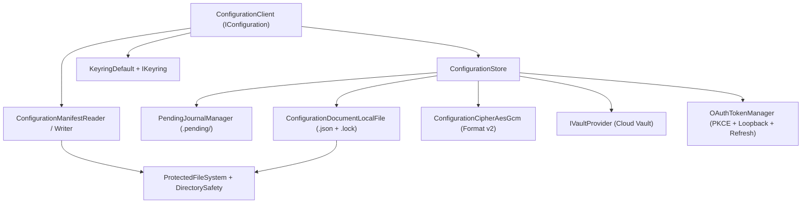

# Node.js Configuration Component Parity - Plan

## Goal Capsule

- **Objective:** Enable Node.js and TypeScript applications to read, write, migrate, authorize, and recover settings and secrets using the same on-disk manifest, namespace files, OS keychains, external vaults, OAuth grants, and crash-recovery journals as `.NET` applications using `NyssaAI.Configuration`.
- **Means:** Complete `@nyssa-ai/configuration` under `nyssa-ai-configuration/` across all 10 roadmap items (`R-001` through `R-010`) and 39 use cases in `docs/configuration/roadmap.md`, adhering to TypeScript `dev-standards` (`TS-FILE`, `TS-HEADER`, `TS-STRUCTURE`, `TS-BOUNDARY`, `TS-NAME`, `TS-DATA`, `TS-STRICT`, `TS-FAILURE`, `TS-LOG`, `TS-CONSTRUCTION`, `TS-TEST`) (KTD1, KTD2).
- **Authority Hierarchy:** Product security invariants (`docs/configuration/product.md`) > Cross-runtime wire & locking compatibility with `NyssaAI.Configuration` > TypeScript `dev-standards` > Convenience.
- **Stop Conditions:** All 10 implementation units (`U1`–`U10`) implemented, verified by unit and use-case tests covering `F-001` through `F-204`, passing `tsc --noEmit` and the `dev-standards` TypeScript conformance checker.

---

## Product Contract

### Summary

`@nyssa-ai/configuration` provides cross-platform, cross-process safe configuration and secret management for Node.js services and CLI tools with 100% behavioral and on-disk parity with the C# `NyssaAI.Configuration` library (`docs/configuration/product.md`). It supports plaintext settings, `aesLocal` AES-256-GCM encrypted values backed by OS keychains, external cloud vault providers (`IVaultProvider`), OAuth 2.0 Authorization Code + PKCE credentials, explicit provider migration (`move`), and crash-resilient write-ahead journals (`.pending/`).

### Problem Frame

Node.js services and CLI tools operating alongside `.NET` applications on shared developer workstations or production hosts need to share `~/.nyssa-ai/config-manifest.json` and `<namespace>.json` files without duplicating configuration stores or leaking secrets through `process.env`. While `nyssa-ai-configuration` currently implements a basic scaffold for `F-001`–`F-101`, it lacks full Windows/POSIX private-file verification, OS keychain delete/platform adapters, key listing, provider-conflict guards, namespace-level typed object replacement/merging (`F-102`), DI/bootstrap extensibility (`F-103`), provider migration (`F-201`), OAuth 2.0 + PKCE lifecycle (`F-202`), external cloud vault integration (`F-203`), and write-ahead crash recovery (`F-204`).

### Requirements

**Foundation (`R-001`–`R-003`)**
- R1. **Cross-Platform File Security & Atomic Locking (`F-001`, `UC-001`–`UC-004`):** Enforce `0700` directories and `0600` files on POSIX and restricted ACLs (Current User, `SYSTEM`, `Administrators`) on Windows; reject group/world-writable directories/files (`DirectorySafety.verify`) and reject group/world/Everyone-readable private files (`DirectorySafety.verifyPrivateFile`) with actionable `chmod`/`icacls` remediation messages that never leak secret values; validate namespace and key names against path traversal (`..`, `/`, `\`, `.pending`, control characters); coordinate reads and writes via `<namespace>.json.lock` with exponential backoff and atomic temp-file renames.
- R2. **Bootstrap Manifest & OS Directory Resolution (`F-002`, `UC-001`–`UC-003`):** Read and atomically provision application sections in `~/.nyssa-ai/config-manifest.json` under `<manifestPath>.lock` while preserving sibling application sections; tolerate JSON comments and trailing commas; validate `version === 1`; enforce `DirectorySafety.verifyPrivateFile` when `keyVault.secrets` is non-empty; resolve relative `configurationDirectory` paths beside the manifest file (`~/.nyssa-ai/<applicationName>` by default); parse `.NET` `TimeSpan` strings (`hh:mm:ss[.fff]`) and normalize `keyVault.settings` and `keyVault.secrets` to empty maps.
- R3. **OS Keyring Master Key Custody & AES-256-GCM Cipher (`F-003`, `UC-001`–`UC-005`):** Manage the 32-byte Master Encryption Key in `IKeyring` (`get`, `set`, `delete`) under `<applicationName>/configuration-key` with OS keychain adapters (Windows Credential Manager, macOS `security`, Linux `secret-tool`) and `KeyringProtectedFile` / `InMemoryKeyring`; never overwrite an existing key on transient keychain failure; seal and open `aesLocal` values using AES-256-GCM FormatVersion 2 (`0x02 || nonce(12) || tag(16) || ciphertext` as unpadded Base64URL with length-prefixed big-endian `(namespace, key)` AAD).

**Core Configuration & Typed Binding (`R-004`–`R-006`)**
- R4. **Namespaced Key-Value CRUD & Provider Routing (`F-101`, `UC-001`–`UC-003`):** Support `get`, `set`, `list`, and `remove` across `"Default"` (plaintext), `"aesLocal"`, and configured vault providers; preserve an existing key's assigned provider when `provider` is omitted on update; reject unrequested provider changes with a Conflict error directing the caller to `move`; return keys from `list` in strict ordinal UTF-16/UTF-8 code-unit order without decrypting or calling remote providers; return `ConfigurationRemoval` (`{ remoteValueRemains: boolean }`) from `remove`.
- R5. **Typed Object Serialization & Namespace-Level Binding (`F-102`, `UC-001`–`UC-005`):** Support keyed typed objects (`getAs<T>(namespace, key)`, `setAs<T>(namespace, key, value)`), whole-namespace replacement (`getNamespace<T>(namespace)`, `setNamespace<T>(namespace, value)`), and partial top-level merging (`mergeSettings<T>(namespace, value)`); preserve exact string literals (including embedded quotes, JSON-like text, and whitespace); preserve nested objects and explicit `null` properties while rejecting non-object payloads (`null`, arrays, primitives) in `mergeSettings`; upgrade legacy `namespaceSettings` JSON-string entries cleanly.
- R6. **Host Dependency Injection & Bootstrap Composition (`F-103`, `UC-001`–`UC-003`):** Infer `applicationName` from package/entry metadata when omitted; support code-level `keyVault` defaults in `ConfigurationOptions` that are replaced whole when the manifest section defines `keyVault`; allow injecting test doubles for `keyring`, `vaultFactories`, `oauthClient`, `browserLauncher`, `clock`, and `logger` without touching real user files or OS keychains.

**Advanced Providers, OAuth & Crash Recovery (`R-007`–`R-010`)**
- R7. **Explicit Provider Migration (`F-201`, `UC-001`–`UC-003`):** Implement `move(namespace, key, destinationProvider)` that reads the cleartext value from its current provider, writes to the destination provider first, updates `<namespace>.json`, deletes the old source copy, and returns `ConfigurationMove` (`{ sourceValueRemains: boolean; sourceDeleteError?: string }`) without losing data if source cleanup is retained or fails.
- R8. **OAuth 2.0 Authorization Code + PKCE & Token Lifecycle (`F-202`, `UC-001`–`UC-006`):** Implement `authorize(namespace, key, options)` using PKCE (`S256`), loopback redirect listener, and state verification, storing the resulting `OAuthGrant` sealed with `aesLocal`; transparently return valid access tokens on `get(namespace, key)` and refresh silently when within 60 seconds of expiry; mark `reauth_required: true` and fail with an Unauthorized error when the authorization server returns `invalid_grant`; persist rotated grants to `.pending/<namespace>.oauth.json` before updating `<namespace>.json` so rotated refresh tokens survive disk write failures; support OAuth credentials for external vaults; clean up `.pending/<namespace>.oauth.json` on `remove`.
- R9. **External Cloud Vault Provider & Multi-Provider Assembly (`F-203`, `UC-001`–`UC-003`):** Define `IVaultProvider` (`getSecret`, `setSecret`, `deleteSecret`) and `IVaultProviderFactory`; store only versionless `"namespace/key"` pointers in `<namespace>.json` for vault-backed entries; assemble and decompose multi-provider namespace objects seamlessly across `"Default"`, `"aesLocal"`, and vault providers; reject storing or moving the vault's own credential key (`keyVault.credential`) into that same vault to prevent circular authentication deadlocks.
- R10. **Write-Ahead Journal & Crash Recovery (`F-204`, `UC-001`–`UC-004`):** Record `.pending/<namespace>.journal.json` before multi-key namespace writes and `.pending/<namespace>.move.json` before source cleanup during `move`, capturing `expectedExistingSha256` and `plannedNewSha256`; automatically replay pending journals before subsequent operations or via `recoverWrite(handle)`; support `ConfigurationWriteRecoveryHandle` export/import across restarts; detect manual reconciliation (`currentSha256 === plannedNewSha256`) and halt with Conflict if `<namespace>.json` was modified by another writer.

### Key Decisions

- **KD1. Monorepo Package Root at `nyssa-ai-configuration/`:** *(session-settled: user-directed — chosen over `packages/configuration`: matches repository root sibling layout alongside `NyssaAI.Configuration`)*. Governs R1–R10.
- **KD2. Zero External Runtime Dependencies:** Use Node.js built-in modules (`node:crypto`, `node:fs`, `node:http`, `node:child_process`, `node:os`, `node:path`) for AES-256-GCM, SHA-256, PKCE, loopback HTTP redirect capture, and OS keychain CLI/API invocation. Governs R1, R3, R8, R10.

---

## Planning Contract

### Key Technical Decisions

- KTD1. **Package Location & Strict TypeScript Layout:** *(session-settled: user-directed — chosen over `packages/configuration`: keeps all monorepo components at root level)*. Keep the package in `nyssa-ai-configuration/` with feature-first folders (`encryption/`, `fileSecurity/`, `keyring/`, `logging/`, `manifest/`, `oauth/`, `recovery/`, `results/`, `values/`, `vault/`) and zero catch-all folders (`utils/`, `helpers/`, `types/`, `models/`, `contracts/`). Every `.ts` file begins with a `// Responsibility:` comment and ASCII public interface tree per `TS-FILE` and `TS-HEADER`.
- KTD2. **Discriminated-Union `Result<T>` with Structured Error Categories:** Extend `Result<T>` (`src/results/Result.ts`) to carry optional error category metadata (`ErrorCategory`: `"NotFound" | "Validation" | "Conflict" | "Unauthorized" | "Forbidden" | "Unavailable" | "Unexpected"`) alongside `error: string` while preserving `{ readonly ok: true; readonly value: T } | { readonly ok: false; readonly error: string; readonly category?: ErrorCategory }` compatibility so callers and tests can inspect both human/technical messages and failure categories.
- KTD3. **Cross-Platform Permission & Private-File Verification (`F-001`):** On POSIX, `DirectorySafety.verify` rejects `(mode & 0o022) !== 0` (`chmod 700`/`chmod 600`) and `DirectorySafety.verifyPrivateFile` additionally rejects `(mode & 0o044) !== 0` (`group`/`other` read bits, naming `chmod 600 '<path>'`). On Windows, `DirectorySafety` inspects `icacls.exe` output (or injected permission metadata) for `Everyone` (`*S-1-1-0`), `Authenticated Users` (`*S-1-5-11`), `BUILTIN\Users` (`*S-1-5-32-545`), and `BUILTIN\Guests` (`*S-1-5-32-546`), rejecting write access in `verify` and read/write access in `verifyPrivateFile` with an `icacls "<path>" /inheritance:r ...` remediation message.
- KTD4. **OS Keyring Adapters (`F-003`):** Extend `IKeyring` with `delete(service, account, signal?)` and `get(service, account, signal?)` returning `Result<Buffer | null>` (where `ok(null)` represents an absent key and `fail(...)` represents an unreachable/broken credential store, matching C#'s `Result<string?>` non-divergence rule). Provide `InMemoryKeyring`, `KeyringProtectedFile`, and platform CLI adapters (`KeyringOsPlatform` using PowerShell/CredMan on Windows, `/usr/bin/security` on macOS, and `secret-tool` on Linux).
- KTD5. **Write-Ahead Journal & Pending Recovery Architecture (`F-202`, `F-204`):** Store pending recovery artifacts in `<configDir>/.pending/`:
  - `<namespace>.journal.json` for multi-property namespace writes (`setNamespace`, `mergeSettings`), recording `expectedExistingSha256`, `plannedNewSha256`, `stage` (`"vault"` or `"local"`), `vaultWrites`, and `plannedDocument`.
  - `<namespace>.move.json` for `move()` source cleanup after `<namespace>.json` is published.
  - `<namespace>.oauth.json` for rotated OAuth grants prior to `<namespace>.json` publication.
  Before any normal `get`, `set`, `list`, `remove`, `move`, `setNamespace`, or `mergeSettings` on `<namespace>`, `ConfigurationStore` checks and replays any pending journal for that namespace under the namespace lock.

### High-Level Technical Design

---

## Implementation Units

| U-ID | Title | Primary Files | Depends On |
| :--- | :--- | :--- | :--- |
| U1 | File Security, Windows/POSIX Private-File Verification & Path Validation (`R-001`) | `nyssa-ai-configuration/src/fileSecurity/DirectorySafety.ts`, `nyssa-ai-configuration/src/values/ConfigurationDocumentLocalFile.ts` | — |
| U2 | Manifest Lock, JSONC Parsing, Secret Privacy & Directory Resolution (`R-002`) | `nyssa-ai-configuration/src/manifest/ConfigurationManifestReader.ts`, `nyssa-ai-configuration/src/manifest/ConfigurationManifestWriter.ts` | U1 |
| U3 | Keyring Delete, Non-Divergence Custody & Cross-Account Isolation (`R-003`) | `nyssa-ai-configuration/src/keyring/IKeyring.ts`, `nyssa-ai-configuration/src/keyring/KeyringDefault.ts`, `nyssa-ai-configuration/src/keyring/InMemoryKeyring.ts` | U1 |
| U4 | Namespaced CRUD, Ordinal Key Listing, Provider Preservation & Removal (`R-004`) | `nyssa-ai-configuration/src/values/ConfigurationStore.ts`, `nyssa-ai-configuration/src/values/ConfigurationRemoval.ts` | U1, U3 |
| U5 | Typed Object Serialization, Namespace Replace/Merge & String Fidelity (`R-005`) | `nyssa-ai-configuration/src/ConfigurationClient.ts`, `nyssa-ai-configuration/src/IConfiguration.ts` | U4 |
| U6 | Bootstrap Defaults, Vault Options Override & Testability Seams (`R-006`) | `nyssa-ai-configuration/src/ConfigurationOptions.ts`, `nyssa-ai-configuration/src/ConfigurationClient.ts` | U2, U3, U5 |
| U7 | Explicit Provider Migration (`move`) (`R-007`) | `nyssa-ai-configuration/src/values/ConfigurationMove.ts`, `nyssa-ai-configuration/src/values/ConfigurationStore.ts` | U4 |
| U8 | External Cloud Vault Provider, Multi-Provider Assembly & Circular Guard (`R-009`) | `nyssa-ai-configuration/src/vault/IVaultProvider.ts`, `nyssa-ai-configuration/src/vault/IVaultProviderFactory.ts`, `nyssa-ai-configuration/src/values/ConfigurationStore.ts` | U5, U6, U7 |
| U9 | OAuth 2.0 Authorization Code + PKCE, Token Refresh & Rotated Grant Recovery (`R-008`) | `nyssa-ai-configuration/src/oauth/OAuthOptions.ts`, `nyssa-ai-configuration/src/oauth/OAuthTokenManager.ts`, `nyssa-ai-configuration/src/oauth/IOAuthFlowClient.ts` | U3, U4, U8 |
| U10 | Write-Ahead Journal, Move Cleanup Recovery & Conflict Detection (`R-010`) | `nyssa-ai-configuration/src/recovery/ConfigurationWriteRecoveryHandle.ts`, `nyssa-ai-configuration/src/recovery/PendingJournalManager.ts` | U5, U7, U8 |

### U1. File Security, Windows/POSIX Private-File Verification & Path Validation (`R-001`)
- **Goal:** Complete `F-001` (`UC-001`–`UC-004`) by enforcing POSIX and Windows write/read permission verification with actionable remediation messages, validating namespace/key names against path traversal, and ensuring bounded cross-process lock coordination.
- **Requirements:** R1 (per KD1, KD2)
- **Dependencies:** None
- **Files:**
  - `nyssa-ai-configuration/src/results/Result.ts`
  - `nyssa-ai-configuration/src/fileSecurity/DirectorySafety.ts`
  - `nyssa-ai-configuration/src/fileSecurity/ProtectedFileSystem.ts`
  - `nyssa-ai-configuration/src/values/ConfigurationDocumentLocalFile.ts`
  - `nyssa-ai-configuration/test/unit/ProtectedFileSystem.test.ts`
  - `nyssa-ai-configuration/test/unit/DocumentLock.test.ts`
- **Approach:**
  1. Add optional `ErrorCategory` to `Result<T>` in `Result.ts` (`fail(error, category?)`).
  2. Enhance `DirectorySafety.verify` and `DirectorySafety.verifyPrivateFile` (KTD3):
     - On POSIX, `verify` rejects `0o022` (naming `group` or `other` and `chmod 700` / `chmod 600`); `verifyPrivateFile` rejects `0o044` (`GroupRead` / `OtherRead`, naming `group` or `other` and `chmod 600 '<path>'`).
     - On Windows, inspect ACLs via `icacls.exe` to detect Allow rules for `Everyone`, `Authenticated Users`, `BUILTIN\Users`, or `BUILTIN\Guests` (`(W)`, `(M)`, `(F)` for `verify`, and `(R)`, `(RX)`, `(M)`, `(F)` for `verifyPrivateFile`), returning `"Forbidden"` with an `icacls` remediation command.
  3. Add segment validation in `ConfigurationDocumentLocalFile` / `ConfigurationStore` rejecting blank names, `..`, `/`, `\`, `.pending`, and control characters with `"Validation"` category.
- **Patterns to follow:** `NyssaAI.Configuration/src/FileSecurity/DirectorySafety.cs`, `NyssaAI.Configuration/src/Values/ConfigurationDocumentLocalFile.cs`
- **Test scenarios:**
  - `directorySafety_protectedDirectory_succeeds`: Newly created directory via `ProtectedFileSystem.createDirectory` passes `DirectorySafety.verify`.
  - `directorySafety_worldWritableFileOrDir_failsWithRemediation`: Group/world-writable on POSIX or `Everyone:(W)` on Windows fails with `"Forbidden"` and names `chmod` or `icacls`.
  - `directorySafety_privateFileReadableByOthers_failsWithRemediation`: `GroupRead`/`OtherRead` on POSIX or `Everyone:(R)` on Windows fails `verifyPrivateFile` with `"Forbidden"` and names `chmod 600` or `icacls`.
  - `documentLocalFile_concurrentWriters_preservesBothKeys`: Concurrent `modify` calls serialize under `.lock` and preserve all keys.
  - `documentLocalFile_lockHeldPastTimeout_returnsUnavailable`: Lock held longer than `lockTimeoutMs` fails with `"Unavailable"`.
- **Verification:** `npm run test:unit` passes all file security and locking scenarios on the current OS.

### U2. Manifest Lock, JSONC Parsing, Secret Privacy & Directory Resolution (`R-002`)
- **Goal:** Complete `F-002` (`UC-001`–`UC-003`) for reading and provisioning `config-manifest.json` with JSON comment/trailing-comma support, version validation, private-file verification when `keyVault.secrets` is populated, and cross-process manifest locking.
- **Requirements:** R2 (per KD1)
- **Dependencies:** U1
- **Files:**
  - `nyssa-ai-configuration/src/manifest/ConfigurationManifest.ts`
  - `nyssa-ai-configuration/src/manifest/ConfigurationManifestReader.ts`
  - `nyssa-ai-configuration/src/manifest/ConfigurationManifestWriter.ts`
  - `nyssa-ai-configuration/src/manifest/TimeSpanParser.ts`
  - `nyssa-ai-configuration/test/unit/ManifestReader.test.ts`
- **Approach:**
  1. Add `credential?: string` to `VaultOptions` in `ConfigurationManifest.ts` and normalize `settings` and `secrets` to `{}` when omitted.
  2. In `ConfigurationManifestReader`, verify `DirectorySafety.verify(manifestPath)` before reading, strip `//` and `/* */` comments and trailing commas outside string literals before `JSON.parse`, validate `version === 1`, validate positive `lockTimeout` via `TimeSpanParser`, and when `keyVault.secrets` has 1+ entries, enforce `DirectorySafety.verifyPrivateFile(manifestPath)` without ever including secret values in the error message.
  3. In `ConfigurationManifestWriter`, acquire `<manifestPath>.lock` with bounded timeout before reading, merging the application's `configurationDirectory`, and atomically renaming the temporary file into place.
- **Patterns to follow:** `NyssaAI.Configuration/src/Manifest/ConfigurationManifestReader.cs`, `NyssaAI.Configuration/src/Manifest/ConfigurationManifestWriter.cs`
- **Test scenarios:**
  - `manifestReader_withCommentsAndTrailingCommas_parsesVaultAndTimeout`: Reads annotated manifest with `lockTimeout`, `keyVault.credential`, `settings`, and empty normalized `secrets`.
  - `manifestReader_unsupportedVersionOrNonPositiveTimeout_failsValidation`: Version `2` or `lockTimeout: "00:00:00"` fails with `"Validation"`.
  - `manifestReader_secretsInReadableFile_failsForbiddenWithoutLeakingSecret`: Manifest containing `secrets.clientSecret` with `Everyone` read (Windows) or `GroupRead`/`OtherRead` (POSIX) fails with `"Forbidden"`, names remediation, and omits `"fictional"` from error messages.
  - `manifestWriter_existingManifest_preservesOtherSectionsAndKeyVault`: Updating `configurationDirectory` preserves sibling apps and existing `keyVault`/`lockTimeout`.
- **Verification:** `npm run test:unit` passes all manifest reader and writer tests.

### U3. Keyring Delete, Non-Divergence Custody & Cross-Account Isolation (`R-003`)
- **Goal:** Complete `F-003` (`UC-001`–`UC-005`) with `delete` support on `IKeyring`, `InMemoryKeyring`, `KeyringOsPlatform`, strict non-divergence key custody, and cross-account isolation verification.
- **Requirements:** R3 (per KD1, KD2)
- **Dependencies:** U1
- **Files:**
  - `nyssa-ai-configuration/src/keyring/IKeyring.ts`
  - `nyssa-ai-configuration/src/keyring/KeyringDefault.ts`
  - `nyssa-ai-configuration/src/keyring/KeyringProtectedFile.ts`
  - `nyssa-ai-configuration/src/keyring/InMemoryKeyring.ts`
  - `nyssa-ai-configuration/src/keyring/KeyringOsPlatform.ts`
  - `nyssa-ai-configuration/test/unit/Keyring.test.ts`
  - `nyssa-ai-configuration/test/unit/CipherAesGcm.test.ts`
- **Approach:**
  1. Update `IKeyring` to define `get(service, account, signal?): Promise<Result<Buffer | null>>`, `set(service, account, secret, signal?): Promise<Result<void>>`, and `delete(service, account, signal?): Promise<Result<void>>` (KTD4).
  2. Implement `InMemoryKeyring` (recording writes and supporting simulated `unreachable` state for use-case tests) and `KeyringOsPlatform` (supporting Windows Credential Manager, macOS `security`, and Linux `secret-tool` when opted in).
  3. Update `KeyringDefault.getOrCreateKey` so `ok(null)` generates and persists a 32-byte key once (returning `{ key, created: true }`), whereas `fail(...)` returns the failure immediately without generating a replacement key.
- **Patterns to follow:** `NyssaAI.Configuration/src/OsKeyring/KeyringManagedSecret.cs`, `NyssaAI.Configuration/test/NyssaAI.Configuration.Tests/Support/InMemoryKeyring.cs`
- **Test scenarios:**
  - `keyringDefault_absentKey_createsOnceAndReusesOnSecondCall`: First call generates 32-byte key and stores it; second call returns the identical key without writing again.
  - `keyringDefault_unreachableStore_failsWithoutCreatingKey`: Simulated store error fails and writes nothing.
  - `keyring_deleteStoredKey_removesOnlyAddressedEntry`: `delete(service, account)` removes the target key while preserving other services/keys; deleting an already absent key succeeds idempotently.
  - `cipherAesGcm_differentUserKey_failsAuthentication`: Encrypted payload copied to a second user's store with a different 32-byte key fails authentication without leaking plaintext (`F-003 UC-005`).
- **Verification:** `npm run test:unit` passes all keyring and cipher tests.

### U4. Namespaced CRUD, Ordinal Key Listing, Provider Preservation & Removal (`R-004`)
- **Goal:** Complete `F-101` (`UC-001`–`UC-003`) by adding `list(namespace)` in strict ordinal order, `ConfigurationRemoval` (`{ remoteValueRemains: boolean }`) on `remove`, and provider-preservation/conflict rules on `set`.
- **Requirements:** R4
- **Dependencies:** U1, U3
- **Files:**
  - `nyssa-ai-configuration/src/values/ConfigurationRemoval.ts`
  - `nyssa-ai-configuration/src/values/ConfigurationStore.ts`
  - `nyssa-ai-configuration/src/IConfiguration.ts`
  - `nyssa-ai-configuration/src/ConfigurationClient.ts`
  - `nyssa-ai-configuration/test/useCase/BasicSettings.usecase.test.ts`
- **Approach:**
  1. Create `ConfigurationRemoval` (`{ readonly remoteValueRemains: boolean }`).
  2. Add `list(namespace, signal?)` to `ConfigurationStore`, `IConfiguration`, and `ConfigurationClient`, sorting keys with strict ordinal comparison (`a < b ? -1 : a > b ? 1 : 0`) without decrypting values.
  3. In `ConfigurationStore.set`, inspect the existing entry in `<namespace>.json`:
     - If `provider` is omitted and no `encrypted` override is passed, preserve the existing entry's provider (`"Default"`, `"aesLocal"`, or vault name).
     - If an explicit `provider` (or `encrypted: false` vs existing `"aesLocal"`/vault) differs from the existing entry's provider, return a `"Conflict"` failure instructing the caller to use `move`.
- **Patterns to follow:** `NyssaAI.Configuration/src/Values/ConfigurationStore.cs`
- **Test scenarios:**
  - `set_existingEncryptedKeyWithoutProvider_preservesEncryption`: Updating a key previously saved under `"aesLocal"` without specifying `provider` keeps it encrypted on disk.
  - `set_existingEncryptedKeyWithDifferentProvider_failsWithConflict`: Calling `set` with `"Default"` on an `"aesLocal"` key fails with `"Conflict"` and leaves the stored value unchanged.
  - `list_mixedCaseKeys_returnsStrictOrdinalOrder`: Keys `["zeta", "Alpha", "alpha", "Beta"]` return as `["Alpha", "Beta", "alpha", "zeta"]`; missing namespace returns `[]`.
  - `remove_localAndMissingKeys_returnsRemoteValueRemainsFalse`: Removing a local or absent key succeeds with `{ remoteValueRemains: false }`.
- **Verification:** `npm test` passes all `F-101` unit and use-case tests.

### U5. Typed Object Serialization, Namespace Replace/Merge & String Fidelity (`R-005`)
- **Goal:** Complete `F-102` (`UC-001`–`UC-005`) for keyed typed objects, whole-namespace replacement (`getNamespace`, `setNamespace`), partial namespace merging (`mergeSettings`), exact string fidelity, and nested object/null handling.
- **Requirements:** R5
- **Dependencies:** U4
- **Files:**
  - `nyssa-ai-configuration/src/IConfiguration.ts`
  - `nyssa-ai-configuration/src/ConfigurationClient.ts`
  - `nyssa-ai-configuration/src/values/ConfigurationStore.ts`
  - `nyssa-ai-configuration/test/useCase/NamespaceSettings.usecase.test.ts`
- **Approach:**
  1. Ensure string values saved via `set` or `setAs` round-trip through `get` and `getAs<string>` with exact literal characters preserved (embedded quotes `He said "hello"`, JSON-looking strings `{"raw":true}`, numbers `"007"`, empty strings `""`, whitespace).
  2. Implement `getNamespace<T>(namespace, signal?)`:
     - If `<namespace>.json` is empty or missing, fail with `"NotFound"`.
     - If `<namespace>.json` has only `"namespaceSettings"`, resolve and parse it (supporting both legacy JSON-encoded string objects and primitive namespace values).
     - Otherwise, resolve every top-level key in `<namespace>.json` through its provider and assemble the resulting object `T`.
  3. Implement `setNamespace<T>(namespace, value, signal?)`:
     - If `value` is a non-null plain object (and not an array), decompose its top-level properties into individual keys in `<namespace>.json`, preserving each surviving key's existing provider, and remove any omitted top-level keys (unless `"namespaceSettings"` is encrypted and would be overwritten by plaintext shorthand, which fails with `"Conflict"`).
     - If `value` is a primitive/string, store it under `"namespaceSettings"` and remove other keys.
  4. Implement `mergeSettings<T>(namespace, value, signal?)`:
     - Validate that `value` is a non-null plain JSON object (`typeof value === "object" && value !== null && !Array.isArray(value)`); otherwise fail with `"Validation"` without modifying `<namespace>.json`.
     - If a legacy `"namespaceSettings"` object exists, expand its properties first, then update only the supplied top-level properties (preserving omitted top-level keys and preserving each updated key's provider; nested objects replace their top-level key whole, and explicit `null` properties store `null`).
- **Patterns to follow:** `NyssaAI.Configuration/src/Client/ConfigurationClient.cs`, `test/NyssaAI.Configuration.UseCaseTests/NamespaceSettingsTutorials.cs`, `test/NyssaAI.Configuration.UseCaseTests/NamespaceWriteTutorials.cs`
- **Test scenarios:**
  - `setAs_keyedObject_roundTripsWholeObjectUnderSingleKey`: Saving `MailServerSettings` under `("mail", "primary")` stores one key and reads it back intact (`UC-001`).
  - `setNamespace_replaceMode_removesOmittedTopLevelKeysAndPreservesProviders`: Saving updated object removes omitted top-level keys while keeping `"aesLocal"` on surviving encrypted keys (`UC-002`).
  - `mergeSettings_partialObject_preservesOmittedTopLevelKeys`: Merging partial update updates specified keys and leaves other keys untouched (`UC-003`).
  - `get_stringWithLiteralQuotesAndJsonText_preservesExactCharacters`: Strings with quotes, JSON syntax, and leading zeros round-trip identically (`UC-004`).
  - `namespaceWrite_nestedObjectsNullsAndEmptyObjects_handlesEdgeCases`: Nested objects replace whole at their top-level key, `null` properties persist as `null`, `setNamespace({})` clears keys while `mergeSettings({})` keeps keys, and `mergeSettings(null | [] | 123 | "text")` fails with `"Validation"` (`UC-005`).
- **Verification:** `npm test` passes all `F-102` use-case tests.

### U6. Bootstrap Defaults, Vault Options Override & Testability Seams (`R-006`)
- **Goal:** Complete `F-103` (`UC-001`–`UC-003`) so `ConfigurationClient.initialize` supports zero-setup default application name resolution, code-level `keyVault` defaults overridable by the manifest, and full dependency injection of test doubles.
- **Requirements:** R6
- **Dependencies:** U2, U3, U5
- **Files:**
  - `nyssa-ai-configuration/src/ConfigurationOptions.ts`
  - `nyssa-ai-configuration/src/ConfigurationClient.ts`
  - `nyssa-ai-configuration/test/useCase/SetupTutorials.usecase.test.ts`
- **Approach:**
  1. Make `options?: ConfigurationOptions` optional in `ConfigurationClient.initialize(options?)`, inferring `applicationName` from package/entry script metadata when omitted.
  2. Default first-run `configurationDirectory` to `path.join(path.dirname(manifestPath), applicationName)` (`~/.nyssa-ai/<applicationName>`) when `options.configDirectory` is not provided, matching C# `BootstrapOptions`.
  3. Support `keyVault?: VaultOptions` in `ConfigurationOptions` as developer defaults that are replaced whole if the manifest section defines `keyVault`.
  4. Validate `keyVault` at initialization (requiring registered `kind` in `vaultFactories` and valid `"namespace/key"` format when `credential` is set).
- **Patterns to follow:** `NyssaAI.Configuration/src/Client/ConfigurationServiceCollectionExtensions.cs`, `test/NyssaAI.Configuration.UseCaseTests/SetupTutorials.cs`
- **Test scenarios:**
  - `initialize_zeroSetupWorkstation_provisionsManifestAndKeyring`: Initializing with a temp manifest path provisions the section, creates `"configuration-key"` once in `InMemoryKeyring`, and logs creation (`UC-001`).
  - `initialize_explicitApplicationNameAndCustomManifest_usesOverrides`: Custom `applicationName` and shipped `configManifest` resolve relative directories beside the shipped manifest (`UC-002`).
  - `initialize_manifestVaultOverridesCodeVaultWhole`: Manifest `keyVault` replaces code `keyVault` settings completely (`UC-002`, `F-002 UC-003`).
  - `initialize_isolatedTestDoubles_neverTouchesUserHomeManifest`: Workstation test fixture runs end-to-end without mutating `~/.nyssa-ai/config-manifest.json` (`UC-003`).
- **Verification:** `npm test` passes all `F-103` setup and isolation use-case tests.

### U7. Explicit Provider Migration (`move`) (`R-007`)
- **Goal:** Complete `F-201` (`UC-001`–`UC-003`) by implementing `move(namespace, key, destinationProvider, signal?)` with destination-first write, source cleanup, and `ConfigurationMove` result reporting.
- **Requirements:** R7
- **Dependencies:** U4
- **Files:**
  - `nyssa-ai-configuration/src/values/ConfigurationMove.ts`
  - `nyssa-ai-configuration/src/values/ConfigurationStore.ts`
  - `nyssa-ai-configuration/src/IConfiguration.ts`
  - `nyssa-ai-configuration/src/ConfigurationClient.ts`
  - `nyssa-ai-configuration/test/useCase/ProviderMigration.usecase.test.ts`
- **Approach:**
  1. Define `ConfigurationMove` (`{ readonly sourceValueRemains: boolean; readonly sourceDeleteError?: string }`).
  2. Implement `move(namespace, key, destinationProvider, signal?)`:
     - If `(namespace, key)` is absent, fail with `"NotFound"`.
     - If already on `destinationProvider`, return `ok({ sourceValueRemains: false })` as a no-op.
     - Read the current unsealed value (and `json` flag), write to `destinationProvider` first, atomically update `<namespace>.json`, and if moving away from a remote provider, invoke source cleanup and report `sourceValueRemains` / `sourceDeleteError`.
- **Patterns to follow:** `NyssaAI.Configuration/src/Values/ConfigurationStore.cs`
- **Test scenarios:**
  - `move_plaintextToAesLocal_encryptsInPlaceAndPreservesValue`: Moving `"Default"` key to `"aesLocal"` seals the value on disk and preserves cleartext on `get` (`UC-001`).
  - `move_aesLocalToDefault_restoresPlaintextAndStripsProviderMetadata`: Moving `"aesLocal"` key to `"Default"` writes plaintext and removes `provider`/`encrypted` fields (`UC-002`).
  - `move_sameProvider_isIdempotentNoOp`: Moving a key to its current provider succeeds with `sourceValueRemains: false`.
- **Verification:** `npm test` passes all `F-201` provider migration tests.

### U8. External Cloud Vault Provider, Multi-Provider Assembly & Circular Guard (`R-009`)
- **Goal:** Complete `F-203` (`UC-001`–`UC-003`) by adding `IVaultProvider` / `IVaultProviderFactory`, versionless `"namespace/key"` pointers in `<namespace>.json`, multi-provider object assembly, and circular vault credential detection.
- **Requirements:** R9
- **Dependencies:** U5, U6, U7
- **Files:**
  - `nyssa-ai-configuration/src/vault/IVaultProvider.ts`
  - `nyssa-ai-configuration/src/vault/IVaultProviderFactory.ts`
  - `nyssa-ai-configuration/src/values/ConfigurationStore.ts`
  - `nyssa-ai-configuration/test/useCase/VaultProvider.usecase.test.ts`
- **Approach:**
  1. Define `IVaultProvider` (`name`, `getSecret(secretName, signal?)`, `setSecret(secretName, secretValue, signal?)`, `deleteSecret(secretName, signal?)` returning `Result<{ readonly deleted: boolean; readonly retained: boolean }>`) and `IVaultProviderFactory` (`kind`, `create(settings, getCredential)`).
  2. In `ConfigurationStore`, route reads/writes/moves/removals for `provider === vault.name` to `IVaultProvider` using secret identifier `"${namespace}/${key}"` and storing `{ value: "${namespace}/${key}", provider: vault.name, encrypted: true }` locally.
  3. Reject `set` or `move` targeting `vault.name` when `"${namespace}/${key}" === vaultOptions.credential` with `"Conflict"` (`F-203 UC-003`).
- **Patterns to follow:** `NyssaAI.Configuration/src/Vault/IVaultProvider.cs`, `test/NyssaAI.Configuration.UseCaseTests/NamespaceProvidersTutorials.cs`
- **Test scenarios:**
  - `setAndGet_vaultProvider_storesVersionlessPointerLocallyAndSecretInVault`: Secret lands in vault under `"mail/password"`, local file contains only pointer `"mail/password"`, and `get` retrieves the secret (`UC-001`).
  - `getNamespaceAndSetNamespace_mixedProviders_assemblesAndRoutesEachProperty`: Object with plaintext `Host`, `"aesLocal"` `UserName`, and vault `Password` assembles on `getNamespace` and routes each property back to its provider on `setNamespace` / `mergeSettings` (`UC-002`).
  - `setOrMove_vaultCredentialIntoSameVault_failsWithConflict`: Attempting to store or move the vault's own `credential` key into that vault fails with `"Conflict"` (`UC-003`).
  - `removeAndMove_vaultRetainsOrFailsDelete_reportsRemoteRetentionAndDeleteError`: Vault retention sets `remoteValueRemains: true` on `remove` and `sourceValueRemains: true` / `sourceDeleteError` on `move` (`F-101 UC-003`, `F-201 UC-003`).
- **Verification:** `npm test` passes all `F-203` vault provider and multi-provider tests.

### U9. OAuth 2.0 Authorization Code + PKCE, Token Refresh & Rotated Grant Recovery (`R-008`)
- **Goal:** Complete `F-202` (`UC-001`–`UC-006`) by implementing interactive PKCE authorization (`authorize`), silent token refresh within the 60-second expiry window, `reauth_required` marking on `invalid_grant`, rotated grant preservation in `.pending/<namespace>.oauth.json`, vault OAuth credential resolution, and credential removal.
- **Requirements:** R8 (per KD2, KTD5)
- **Dependencies:** U3, U4, U8
- **Files:**
  - `nyssa-ai-configuration/src/oauth/OAuthOptions.ts`
  - `nyssa-ai-configuration/src/oauth/IOAuthFlowClient.ts`
  - `nyssa-ai-configuration/src/oauth/OAuthTokenManager.ts`
  - `nyssa-ai-configuration/src/IConfiguration.ts`
  - `nyssa-ai-configuration/src/ConfigurationClient.ts`
  - `nyssa-ai-configuration/test/useCase/OAuthTutorials.usecase.test.ts`
- **Approach:**
  1. Define `OAuthOptions` (`authority`, `clientId`, `authorizationEndpoint`, `tokenEndpoint`, `scopes`), `IBrowserLauncher`, and `IOAuthFlowClient` (with default HTTP/loopback implementation and injectable test double).
  2. Implement `authorize(namespace, key, options, signal?)`:
     - Generate 32-byte PKCE `code_verifier`, `S256` `code_challenge`, and random `state`.
     - Obtain authorization code via loopback redirect / `IOAuthFlowClient`, verify `state`, exchange code for tokens, and persist the encrypted `OAuthGrant` under `(namespace, key)` with `provider: "aesLocal"`, `encrypted: true`, and `reauth_required: false`.
  3. On `get(namespace, key)`:
     - When the decrypted payload is an `OAuthGrant` (or a pending rotated grant exists in `.pending/<namespace>.oauth.json`), check `reauth_required` (failing with `"Unauthorized"` if true).
     - If `expiresAt <= now + 60s`, exchange `refresh_token` for a new token pair:
       - On `invalid_grant`, set `reauth_required: true` in `<namespace>.json` and return `"Unauthorized"`.
       - On success, write encrypted rotated grant to `.pending/<namespace>.oauth.json` first, then update `<namespace>.json`, then delete `.pending/<namespace>.oauth.json` (`F-202 UC-004`).
     - Return the valid `access_token`.
- **Patterns to follow:** `NyssaAI.Configuration/src/OAuth/`, `test/NyssaAI.Configuration.UseCaseTests/OAuthTutorials.cs`
- **Test scenarios:**
  - `authorize_interactiveSignIn_storesEncryptedGrantAndReturnsAccessToken`: `authorize` launches browser once with PKCE `S256`, seals grant under `"aesLocal"`, and `get` returns the access token (`UC-001`).
  - `get_expiredAccessToken_refreshesSilentlyWithoutBrowser`: Advancing clock past expiry triggers silent refresh, persists rotated refresh token, and returns new access token with 0 browser launches (`UC-002`).
  - `get_revokedRefreshToken_marksReauthRequiredAndRecoversAfterReauthorize`: Revoked refresh token fails with `"Unauthorized"`, sets `reauth_required: true` on disk, and recovers after calling `authorize` again (`UC-003`).
  - `get_rotatedGrantDiskWriteFailure_recoversFromPendingFileWithoutBrowser`: Simulated failure writing `<namespace>.json` after token rotation preserves the rotated grant in `.pending/mail.oauth.json` and completes on the next `get` with 0 browser launches (`UC-004`).
  - `authorize_vaultCredential_authenticatesVaultRequestsAndRefreshesAutomatically`: Vault configured with `credential: "vault/token"` uses the OAuth access token to read/write vault secrets (`UC-005`).
  - `remove_authorizedCredential_removesEntryAndReturnsRemoteValueRemainsFalse`: Removing an OAuth key deletes it from `<namespace>.json` (and any `.pending` file), returns `{ remoteValueRemains: false }`, and subsequent `get` fails with `"NotFound"` (`UC-006`).
- **Verification:** `npm test` passes all 6 `F-202` OAuth use-case tests.

### U10. Write-Ahead Journal, Move Cleanup Recovery & Conflict Detection (`R-010`)
- **Goal:** Complete `F-204` (`UC-001`–`UC-004`) by implementing write-ahead journals (`.pending/<namespace>.journal.json` and `.pending/<namespace>.move.json`), `ConfigurationWriteRecoveryHandle` (`export` / `import`), `recoverWrite`, automatic replay before normal operations, and SHA-256 conflict/manual-reconciliation detection.
- **Requirements:** R10 (per KTD5)
- **Dependencies:** U5, U7, U8
- **Files:**
  - `nyssa-ai-configuration/src/recovery/ConfigurationWriteRecoveryHandle.ts`
  - `nyssa-ai-configuration/src/recovery/PendingJournalManager.ts`
  - `nyssa-ai-configuration/src/values/ConfigurationStore.ts`
  - `nyssa-ai-configuration/src/IConfiguration.ts`
  - `nyssa-ai-configuration/src/ConfigurationClient.ts`
  - `nyssa-ai-configuration/test/useCase/ConfigurationRecovery.usecase.test.ts`
- **Approach:**
  1. Implement `ConfigurationWriteRecoveryHandle` with `export(): string` and `static import(token: string): Result<ConfigurationWriteRecoveryHandle>` validating schema version and namespace safety (`UC-002`).
  2. Implement `PendingJournalManager` managing `.pending/<namespace>.journal.json` and `.pending/<namespace>.move.json`:
     - Before multi-key writes (`setNamespace`, `mergeSettings`), compute `expectedExistingSha256` of `<namespace>.json` and `plannedNewSha256` of the planned `<namespace>.json`, write `.pending/<namespace>.journal.json` (`stage: "vault"`), execute vault writes, transition journal to `stage: "local"`, atomically publish `<namespace>.json`, and delete the journal. If a vault write or local publish fails after journal creation, attach `recoveryHandle` to the returned failure `Result` (`UC-001`).
     - During `move()` from a remote vault provider, write `.pending/<namespace>.move.json` before publishing `<namespace>.json`, then delete the remote vault secret and remove `.pending/<namespace>.move.json` (`UC-003`).
     - During recovery (`recoverWrite(handle)` or automatic pre-operation replay):
       - Compare current `<namespace>.json` SHA-256 against `expectedExistingSha256` and `plannedNewSha256`:
         - If `currentSha256 === plannedNewSha256`, treat local file as reconciled, ensure remaining cleanup finishes, and delete the journal (`UC-004`).
         - If `currentSha256 !== expectedExistingSha256`, fail with `"Conflict"` and preserve the journal (`UC-004`).
         - Otherwise replay remaining vault writes (at `stage: "vault"`) and publish `<namespace>.json` (at `stage: "local"`), then delete the journal (`UC-001`).
- **Patterns to follow:** `NyssaAI.Configuration/src/Values/ConfigurationStore.cs`, `test/NyssaAI.Configuration.UseCaseTests/ConfigurationRecoveryTutorials.cs`
- **Test scenarios:**
  - `recoverWrite_interruptedAtVaultOrLocalStage_completesWriteAndDeletesJournal`: Simulated mid-batch vault failure or local publish failure leaves `.pending/<ns>.journal.json`, and `recoverWrite` (or next `getNamespace`) finishes the write and removes the journal (`UC-001`).
  - `recoveryHandle_exportAndImport_roundTripsAndRejectsTamperedTokens`: Exported recovery handle imports in a new client instance to finish recovery; malformed or path-traversal tokens fail with `"Validation"` (`UC-002`).
  - `move_interruptedBeforeSourceDelete_recoversSourceCleanupOnNextOperation`: Simulated crash after `<namespace>.json` update during `move` leaves `.pending/<ns>.move.json`, and the next operation deletes the old vault copy and removes the move journal (`UC-003`).
  - `recoverWrite_concurrentEditOrManualReconciliation_detectsConflictOrClearsJournal`: Concurrent modification to `<namespace>.json` fails recovery with `"Conflict"` and preserves `.pending/<ns>.journal.json`; manual edit matching `plannedNewSha256` succeeds and deletes the journal (`UC-004`).
- **Verification:** `npm test` passes all `F-204` recovery unit and use-case tests.

---

## Verification Contract

| Check | Command | Working Directory | Pass Criterion |
| :--- | :--- | :--- | :--- |
| Unit tests | `npm run test:unit` | `nyssa-ai-configuration` | All unit tests pass (0 failures) |
| Public use-case tests (`F-001`–`F-204`) | `npm run test:usecase` | `nyssa-ai-configuration` | All 39 use cases across `F-001`–`F-204` pass (0 failures) |
| TypeScript strict typecheck | `npm run typecheck` | `nyssa-ai-configuration` | `tsc --noEmit` exits 0 |
| Package build | `npm run build` | `nyssa-ai-configuration` | `dist/` builds cleanly |
| `dev-standards` TypeScript checker | `node "C:/Users/jmayn/.gemini/config/plugins/dev-standards/src/typescript/check.mjs" nyssa-ai-configuration` | repo root | 0 rule violations |

---

## Definition of Done

- All 10 implementation units (`U1`–`U10`) are implemented in `nyssa-ai-configuration/` covering `R-001` through `R-010` and all 39 use cases (`UC-nnn`).
- Every authored `.ts` file begins with a Single Responsibility header comment and synchronized ASCII public interface tree (`TS-HEADER`).
- Strict TypeScript compiler flags (`strict`, `noUncheckedIndexedAccess`, `exactOptionalPropertyTypes`, `verbatimModuleSyntax`) pass with zero `any` types (`TS-STRICT`).
- All unit tests, use-case tests, and `dev-standards` deterministic checks pass with zero failures.
- No abandoned experimental or dead-end code remains in the working tree.
