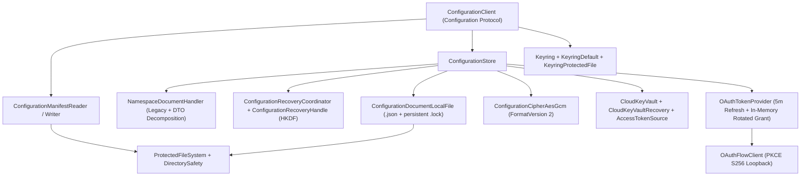

# Python Configuration Component Standards Compliance & Parity - Plan

## Goal Capsule

- **Objective:** Refactor and complete `nyssa-ai-configuration-py` to achieve 100% compliance with repository Python development standards ([.nyssa-ai/dev-standards/python/rules/standards.md](../../.nyssa-ai/dev-standards/python/rules/standards.md)) and cryptographic, wire-format, locking, and recovery parity with .NET (`NyssaAI.Configuration`) and TypeScript (`@nyssa-ai/configuration`).
- **Key Tenet:** All persisted data must use runtime-agnostic JSON primitives (integer milliseconds `lockTimeoutMs` for durations, ISO-8601 UTC strings for dates). Language-specific serialized types (such as .NET `TimeSpan` strings) are strictly prohibited across language boundaries. Locking mechanics must use persistent OS kernel handles without unlinking, with retry-safe handle acquisition for Windows `FileShare.None` interoperability.
- **Authority Hierarchy:** Product security and architectural boundaries ([docs/configuration/product.md](../product.md)) > Feature contracts (`F-001`–`F-204`) > Cross-runtime wire & cryptographic compatibility with `NyssaAI.Configuration` > Python `dev-standards` > Convenience.
- **Stop Conditions:** All 11 implementation units (`U1`–`U11`) implemented, verified by unit (`test/unit/`) and use-case (`test/use_case/`) test suites covering `F-001` through `F-204`, passing `mypy --strict` with zero `Any` types, and passing `python .nyssa-ai/dev-standards/python/scripts/check_adoption.py . --run --use-case`.

---

## 1. Problem Frame & Root Causes

The current Python package under `nyssa-ai-configuration-py/` is an early prototype with critical gaps across four dimensions:

1. **Standards & Checker Violations (`dev-standards/python`):**
   - **`PY-FAILURE`**: Defines custom raised exceptions in `exceptions.py` and raises them for expected control flow instead of returning discriminated-union `Result[T, ConfigurationError] = Ok[T] | Err[ConfigurationError]`.
   - **`PY-HEADER`**: Missing `# Responsibility:` single-responsibility summaries and `# Public interface:` ASCII contract trees across modules.
   - **`PY-NAME`**: Uses C#-style `I` prefixes on protocols (`IVaultProvider`, `IVaultProviderFactory`, `IKeyring`).
   - **`PY-STRICT`**: Uses `typing.Any` across dictionaries and return types (`val: Any`, `Dict[str, Any]`), bypassing strict static typing.
   - **`PY-FILE` & `PY-STRUCTURE`**: `client.py` is 473 lines (hard limit is 350 lines; >100 lines discouraged); modules are named generically (`client.py`, `encryption.py`, `models.py`) instead of matching `to_snake_case(PrimaryClassName).py` or grouping pure DTOs in `types.py`; catch-all `models.py` violates the forbidden catch-all rule.
   - **`PY-TEST`, `REPO-TEST-LAYOUT`, & `.nyssa-ai/dev-standards/python.json`**: Tests are grouped under `tests/` instead of `test/unit/` and `test/use_case/`, and `.nyssa-ai/dev-standards/python.json` still points `unit` and `use_case` commands at `nyssa-ai-configuration-py/tests`.
   - **`PY-LOG` & `PY-LIFETIME`**: Action-taking classes lack constructor-injected structured loggers, monotonic elapsed timing (`time.monotonic()`), secret redaction guarantees, sink-failure containment, and injected clocks/transports.

2. **Cross-Runtime Type Persistence & Wire-Format Divergences:**
   - Durations must standardize on integer milliseconds (`lockTimeoutMs: 10000`) while retaining backward-compatible reader support for legacy .NET `TimeSpan` strings (`"lockTimeout": "00:00:10"`).
   - `<namespace>.json` entry serialization must match .NET's `ConfigurationValueJsonConverter` byte-for-byte:
     - Omit boolean flags (`encrypted`, `reauth_required`, `json`) when `False`, and omit `provider` when `""` (literal).
     - Cloud vault entries (`provider: "<vaultName>"`) store a local `ConfigurationPointer` and **must omit `"encrypted": true`** because the pointer itself is not ciphertext (`F-203`).
     - Emit `"json": true` if and only if `is_json_value and (not is_literal or value.lstrip().startswith('"'))`.
   - `list(namespace)` must sort keys in **UTF-16 code-unit ordinal order** (`key=lambda s: s.encode("utf-16-be")`) to match .NET `StringComparer.Ordinal` and JavaScript `<` across supplementary Unicode planes (`F-101`).

3. **Cross-Process & In-Process Locking Mechanics:**
   - Lock files (`<path>.lock`) must be persistent and **never unlinked**.
   - On Windows, when .NET holds `<path>.lock` with `FileShare.None`, `os.open()` itself raises `PermissionError` (`ERROR_SHARING_VIOLATION`). Therefore, both an in-process per-path lock gate (`threading.Lock`) and `os.open()` + `msvcrt.locking()` must execute inside the backoff retry loop, closing the file descriptor before sleeping whenever lock acquisition fails so Python never starves a `FileShare.None` waiter.

4. **Product & Feature Contract Gaps (`F-001`–`F-204`):**
   - Lacks POSIX (`0700`/`0600`) and Windows DACL (`icacls`) verification and reserved segment validation (`F-001`).
   - Lacks JSONC comment/trailing-comma stripping and private-file verification when `keyVault.secrets` is non-empty (`F-002`).
   - Lacks legacy `"namespaceSettings"` read compatibility, replace migration, merge property expansion, and provider-conflict checks (`F-102`).
   - Lacks OAuth 2.0 PKCE loopback authorization (`authorize`, `authorize_provider`, `reauthorize`), 5-minute pre-expiry refresh under namespace lock, and **in-memory rotated grant retention** when local disk publication fails transiently (`F-202`).
   - Lacks core cloud vault adapter contracts (`CloudKeyVault`, `CloudKeyVaultFactory`, `AccessTokenSource`, `ConfigurationPointer`) and circular credential prevention without bundling third-party vault SDKs (`F-203`).
   - Lacks guarded two-phase recovery (`CloudKeyVaultRecovery`, `ConfigurationOperationProgress`, HKDF-SHA256 authenticated `ConfigurationRecoveryHandle` with `export()`/`import_token()`, and caller-triggered `recover(handle)`) without forbidden `.pending/` on-disk write-ahead journals (`F-204`).

---

## 2. Technical Decisions & Target Architecture

- **TD1. Polyglot Wire & Type Persistence Standard:**
  - `config-manifest.json` writes `lockTimeoutMs: int` (milliseconds) and reads `lockTimeoutMs` first with fallback to `lockTimeout`.
  - `<namespace>.json` follows .NET's `ConfigurationValueJsonConverter` omission and `"json": true` rules exactly.
  - Ordinal key sorting uses `s.encode("utf-16-be")` to match .NET `StringComparer.Ordinal` and JS UTF-16 code units.
- **TD2. Discriminated Union `Result[T, ConfigurationError]` (`PY-FAILURE`):**
  - `Ok[T]` and `Err[E]` frozen slots dataclasses in `results/result.py` (where `Result: TypeAlias = Ok[T] | Err[E]` satisfies `check.py`'s union-arm rule).
  - Pure error DTOs (`ErrorCategory`, `ConfigurationError`) grouped in `results/types.py` (satisfying `PY-FILE` for pure frozen dataclasses and `Literal` aliases).
- **TD3. Persistent Kernel Handle Locking (`F-001`):**
  - Lock files (`<path>.lock`) are created once and **never unlinked**.
  - An in-process per-path `threading.Lock` serializes threads inside the current Python process before acquiring the OS file descriptor.
  - Inside the timeout retry loop: open `<path>.lock` with `os.O_CREAT | os.O_RDWR` (catching `PermissionError`/`OSError` when .NET holds `FileShare.None`), lock via `msvcrt.locking(fd, msvcrt.LK_NBLCK, 1)` on Windows or `fcntl.flock(fd, fcntl.LOCK_EX | fcntl.LOCK_NB)` on POSIX, and close `fd` immediately before sleeping if locking fails.
- **TD4. Single-Concept Module Layout Passing `check.py` (`PY-FILE`, `PY-STRUCTURE`):**
  Every file in `src/nyssa_ai_configuration/` is either a single behavioral class/protocol file named `to_snake_case(ClassName).py` or a feature-scoped `types.py` containing only pure `@dataclass(frozen=True, slots=True)` / `Enum` / `Literal` types:
  - `results/types.py` (`ErrorCategory`, `ConfigurationError`)
  - `results/result.py` (`Ok`, `Err`, `Result`)
  - `logging/configuration_logger.py` (`ConfigurationLogger` protocol)
  - `logging/types.py` (`ConfigurationLogRecord`)
  - `file_security/directory_safety.py` (`DirectorySafety`)
  - `file_security/protected_file_system.py` (`ProtectedFileSystem`)
  - `manifest/types.py` (`VaultOptions`, `ApplicationManifestEntry`, `BootstrapOptions`)
  - `manifest/configuration_manifest_reader.py` (`ConfigurationManifestReader`)
  - `manifest/configuration_manifest_writer.py` (`ConfigurationManifestWriter`)
  - `keyring/keyring.py` (`Keyring` protocol)
  - `keyring/keyring_default.py` (`KeyringDefault`)
  - `keyring/keyring_protected_file.py` (`KeyringProtectedFile`)
  - `encryption/configuration_cipher.py` (`ConfigurationCipher` protocol)
  - `encryption/configuration_cipher_aes_gcm.py` (`ConfigurationCipherAesGcm`)
  - `values/types.py` (`ConfigurationValue`, `ConfigurationRemoval`, `ConfigurationMove`)
  - `values/configuration_value_codec.py` (`ConfigurationValueCodec`)
  - `values/configuration_document_local_file.py` (`ConfigurationDocumentLocalFile`)
  - `values/namespace_document_handler.py` (`NamespaceDocumentHandler`)
  - `values/configuration_store.py` (`ConfigurationStore`)
  - `cloud_key_vaults/types.py` (`ConfigurationPointer`, `CloudKeyVaultAction`, `CloudKeyVaultOperation`, `CloudKeyVaultPreparation`, `CloudKeyVaultStepEffect`)
  - `cloud_key_vaults/access_token_source.py` (`AccessTokenSource` protocol)
  - `cloud_key_vaults/cloud_key_vault.py` (`CloudKeyVault` protocol)
  - `cloud_key_vaults/cloud_key_vault_recovery.py` (`CloudKeyVaultRecovery` protocol)
  - `cloud_key_vaults/cloud_key_vault_factory.py` (`CloudKeyVaultFactory` protocol)
  - `oauth/types.py` (`OAuthOptions`, `OAuthToken`)
  - `oauth/browser_launcher.py` (`BrowserLauncher` protocol)
  - `oauth/oauth_flow_client.py` (`OAuthFlowClient`)
  - `oauth/oauth_token_provider.py` (`OAuthTokenProvider`)
  - `recovery/types.py` (`ConfigurationOperationKind`, `ConfigurationStepState`, `ConfigurationPublicationState`, `ConfigurationRecoveryStatus`, `ConfigurationStepProgress`, `ConfigurationOperationProgress`, `ConfigurationRecoveryOutcome`)
  - `recovery/configuration_recovery_handle.py` (`ConfigurationRecoveryHandle`)
  - `recovery/configuration_recovery_token_protector.py` (`ConfigurationRecoveryTokenProtector`)
  - `recovery/configuration_recovery_coordinator.py` (`ConfigurationRecoveryCoordinator`)
  - `configuration.py` (`Configuration` protocol)
  - `configuration_client.py` (`ConfigurationClient`)
- **TD5. Operational Logging & Explicit Lifetimes (`PY-LOG`, `PY-LIFETIME`):**
  - Every action-taking class (`ConfigurationClient`, `ConfigurationStore`, `ConfigurationManifestWriter`, `OAuthTokenProvider`, `ConfigurationDocumentLocalFile`, `ConfigurationRecoveryCoordinator`) accepts an optional `logger: ConfigurationLogger | None = None` and clock (`clock: Callable[[], float] = time.monotonic`) via `__init__`.
  - Emits structured terminal boundary records (`info`/`warn`/`error`) and `debug` step telemetry with monotonic `elapsed_ms`, correlation ID, operation, and outcome.
  - Strictly redacts secrets, ciphertexts, OAuth tokens, recovery handles, and raw exception strings; wraps sink writes in a local containment guard so faulty sinks never alter business `Result` outcomes.
- **TD6. Guarded Two-Phase Recovery Without Disk Journals (`F-204`):**
  - Zero `.pending/` files or background retry threads.
  - Multi-step operations (`move`, `set_namespace`, `merge_settings`) prepare remote vault steps via `CloudKeyVaultRecovery.prepare`, execute conditional writes, track payload-free `ConfigurationOperationProgress`, and issue an HKDF-SHA256 encrypted/authenticated `ConfigurationRecoveryHandle` when interrupted after remote mutations begin.
  - Callers explicitly resume via `recover(handle)`.
- **TD7. Test Layout & Tooling Synchronization (`REPO-TEST-LAYOUT`, `PY-TEST`):**
  - Move tests to `nyssa-ai-configuration-py/test/unit/` and `nyssa-ai-configuration-py/test/use_case/`.
  - Update `.nyssa-ai/dev-standards/python.json` (`commands.unit` -> `nyssa-ai-configuration-py/test/unit`, `commands.use_case` -> `nyssa-ai-configuration-py/test/use_case`) and `nyssa-ai-configuration-py/pyproject.toml` (`testpaths = ["test/unit", "test/use_case"]`).

---

## 3. Implementation Phases

### Phase 1: Standards Baseline, Result Types & Structured Logging Contract (`U1`)
- **Deliverables:**
  - `src/nyssa_ai_configuration/results/types.py`: `ErrorCategory` (`Literal["Validation", "Forbidden", "NotFound", "Conflict", "Unavailable", "Indeterminate", "Canceled", "Unexpected"]`) and `ConfigurationError` frozen slots dataclass with redacted safe cause classification.
  - `src/nyssa_ai_configuration/results/result.py`: `Ok[T]`, `Err[E]`, and `Result: TypeAlias = Ok[T] | Err[E]`.
  - `src/nyssa_ai_configuration/logging/types.py` & `configuration_logger.py`: `ConfigurationLogRecord` and `ConfigurationLogger` protocol with sink-failure containment helper and monotonic elapsed timing.
  - `test/unit/test_result.py`, `test/unit/test_configuration_logger.py`.
- **Rules Satisfied:** `PY-FAILURE`, `PY-LOG`, `PY-FILE`, `PY-HEADER`, `PY-STRICT`.

### Phase 2: File Security & Persistent Kernel Handle Locking (`U2`, `U3`)
- **Deliverables:**
  - `src/nyssa_ai_configuration/file_security/directory_safety.py`: POSIX mode bit checking (`0700` dirs, `0600` secret files), Windows `icacls` DACL inspection (blocking `BUILTIN\Users`, `Everyone`, `Authenticated Users`), and segment validation against path traversal and Windows reserved names (`CON`, `PRN`, `AUX`, `NUL`, `COM1`–`COM9`, `LPT1`–`LPT9`).
  - `src/nyssa_ai_configuration/file_security/protected_file_system.py`: Safe atomic directory creation and atomic file publishing via restricted temp files (`os.replace`).
  - `src/nyssa_ai_configuration/values/configuration_document_local_file.py`:
    - In-process per-path `threading.Lock` gate + cross-process persistent `.lock` file acquisition (`os.open` + `msvcrt.locking` on Windows / `fcntl.flock` on POSIX inside the retry loop, closing `fd` before backoff sleep on contention, never unlinking `.lock`).
    - Emits `Warn` degradation telemetry when lock acquisition requires retries (`PY-LOG`).
  - `test/unit/test_directory_safety.py`, `test/unit/test_document_lock.py`.
- **Rules Satisfied:** `F-001`, `PY-PORTABILITY`, `PY-LOG`, `PY-HEADER`.

### Phase 3: Manifest Resolution, JSONC Stripping & Millisecond Timeouts (`U4`)
- **Deliverables:**
  - `src/nyssa_ai_configuration/manifest/types.py`: `VaultOptions` (with redacted `__repr__` for `secrets`), `ApplicationManifestEntry`, `BootstrapOptions`.
  - `src/nyssa_ai_configuration/manifest/configuration_manifest_reader.py`:
    - Strips `//` and `/* */` JSONC comments and trailing commas outside string literals.
    - Reads `lockTimeoutMs: int` as primary, with fallback parsing for legacy `lockTimeout` strings/numbers.
    - Enforces `DirectorySafety.verify_private_file` when `keyVault.secrets` has 1+ entries.
    - Resolves relative `configurationDirectory` against the manifest's parent directory. Never reads environment variables.
  - `src/nyssa_ai_configuration/manifest/configuration_manifest_writer.py`:
    - Provisions missing manifest or missing application section under `<manifestPath>.lock`.
    - Preserves sibling applications and existing fields verbatim; writes integer `lockTimeoutMs`.
  - `test/unit/test_manifest_reader.py`, `test/unit/test_manifest_writer.py`.
- **Rules Satisfied:** `F-002`, `PY-DATA`, `PY-LOG`, `PY-HEADER`.

### Phase 4: Keyring Custody & Address-Bound Encryption (`U5`)
- **Deliverables:**
  - `src/nyssa_ai_configuration/keyring/keyring.py`: `Keyring` protocol (`get_key`, `set_key`, `delete_key` returning `Result`).
  - `src/nyssa_ai_configuration/keyring/keyring_default.py`: Platform router (Windows Credential Manager via `ctypes` `Advapi32`, macOS Keychain via `security`, Linux Secret Service via `secret-tool`, or `KeyringProtectedFile` only when explicitly configured—never silently regenerating a key on transient OS store failure).
  - `src/nyssa_ai_configuration/keyring/keyring_protected_file.py`: Restricted local key store (`0600` / DACL-verified).
  - `src/nyssa_ai_configuration/encryption/configuration_cipher.py` & `configuration_cipher_aes_gcm.py`: FormatVersion 2 (`0x02` || 12-byte nonce || 16-byte GCM tag || ciphertext) with length-prefixed `(namespace, key)` AAD (`uint32_le(len(ns)) || ns_utf8 || uint32_le(len(key)) || key_utf8`).
  - `test/unit/test_keyring.py`, `test/unit/test_cipher_aes_gcm.py`.
- **Rules Satisfied:** `F-003`, `PY-NAME`, `PY-SECURITY`.

### Phase 5: Core Document Store, Exact Wire Codec & UTF-16 Ordinal Listing (`U6`)
- **Deliverables:**
  - `src/nyssa_ai_configuration/values/types.py`: `ConfigurationValue`, `ConfigurationRemoval`, `ConfigurationMove`.
  - `src/nyssa_ai_configuration/values/configuration_value_codec.py`:
    - Matches .NET `ConfigurationValueJsonConverter` exactly:
      - Plaintext structured JSON values are written directly as raw JSON objects/arrays/primitives without `"json": true`.
      - `"encrypted": true` is emitted only when `encrypted is True` (`aesLocal` and `oauth`), **omitted on cloud vault pointers**.
      - `"provider"` is emitted only when non-empty.
      - `"reauth_required": true` is emitted only when `True`.
      - `"json": true` is emitted if and only if `is_json_value and (not is_literal or value.lstrip().startswith('"'))`.
  - `src/nyssa_ai_configuration/values/configuration_store.py`:
    - `get(namespace, key)`, `set(namespace, key, value, provider?)` (preserving existing provider on update, rejecting unrequested provider changes with `Conflict` directing to `move`).
    - `list(namespace)`: Returns keys sorted by `s.encode("utf-16-be")` to match .NET `StringComparer.Ordinal` and JS UTF-16 code units.
    - `remove(namespace, key)`: Invokes provider removal, updates local document, returns `ConfigurationRemoval`.
  - `test/use_case/test_basic_settings.py`.
- **Rules Satisfied:** `F-101`, `PY-FAILURE`, `PY-DATA`, `PY-LOG`.

### Phase 6: Typed DTO Binding, Namespace Operations & Legacy `namespaceSettings` (`U7`)
- **Deliverables:**
  - `src/nyssa_ai_configuration/values/namespace_document_handler.py`:
    - Decomposes namespace DTOs across top-level properties; rejects user properties named `"namespaceSettings"` or duplicate property names with `Validation`.
    - Reads legacy single-entry `{"namespaceSettings": ...}` documents transparently.
    - Replaces plaintext legacy `namespaceSettings` on `set_namespace`; expands and preserves omitted legacy properties on `merge_settings`; fails with `Conflict` if legacy `namespaceSettings` is provider-backed during property decomposition.
  - `src/nyssa_ai_configuration/configuration.py` & `configuration_client.py`:
    - `get_as(namespace, key, target_type)`, `set_as(namespace, key, value, provider?)` (preserving literal quotes on `str` via `"json": true`).
    - `get_namespace(namespace, target_type)`, `set_namespace(namespace, value)`, `merge_settings(namespace, value)`.
  - `test/use_case/test_namespace_settings.py`, `test/use_case/test_setup_tutorials.py`.
- **Rules Satisfied:** `F-102`, `F-103`, `PY-STRICT`.

### Phase 7: Explicit Provider Migration (`U8`)
- **Deliverables:**
  - `ConfigurationStore.move(namespace, key, destination_provider)`:
    - Validates source entry exists and is not `"oauth"` (`Conflict`).
    - Reads cleartext from source provider, writes to destination provider first, atomically updates `<namespace>.json`, then deletes from source provider.
    - Captures `source_value_remains: True` and `source_delete_error` in `ConfigurationMove` if source cleanup fails after destination publication.
  - `test/use_case/test_provider_migration.py`.
- **Rules Satisfied:** `F-201`, `PY-FAILURE`.

### Phase 8: Pluggable Cloud Key Vault Contracts & Circular Credential Guard (`U9`)
- **Deliverables:**
  - `src/nyssa_ai_configuration/cloud_key_vaults/types.py`: `ConfigurationPointer` (validated `"ns/key"` or opaque provider reference), `CloudKeyVaultAction`, `CloudKeyVaultOperation`, `CloudKeyVaultPreparation`, `CloudKeyVaultStepEffect`.
  - `src/nyssa_ai_configuration/cloud_key_vaults/access_token_source.py`: `AccessTokenSource` protocol (`get_access_token`).
  - `src/nyssa_ai_configuration/cloud_key_vaults/cloud_key_vault.py`: `CloudKeyVault` protocol (`read`, `write`, `remove`).
  - `src/nyssa_ai_configuration/cloud_key_vaults/cloud_key_vault_factory.py`: `CloudKeyVaultFactory` protocol (`kind`, `create`, `authorization`).
  - Circular credential protection in `ConfigurationStore`: rejects writes if `(namespace, key)` is the configured `credential` for the target vault, and rejects `AccessTokenSource` reads if the credential entry resolves through the vault it authenticates.
  - Zero third-party vault SDKs bundled in `src/`; fake cloud vault adapter placed in `test/use_case/` fixtures.
  - `test/use_case/test_vault_provider.py`.
- **Rules Satisfied:** `F-203`, `PY-NAME`, `PY-BOUNDARY`.

### Phase 9: Interactive OAuth 2.0 PKCE Lifecycle & In-Memory Rotated Grant Durability (`U10`)
- **Deliverables:**
  - `src/nyssa_ai_configuration/oauth/types.py`: `OAuthOptions`, `OAuthToken` (self-describing grant storing `access_token`, `refresh_token`, `expires_at`, `authorization_endpoint`, `token_endpoint`, `client_id`, `scopes`, `redirect_port`).
  - `src/nyssa_ai_configuration/oauth/browser_launcher.py`: `BrowserLauncher` protocol.
  - `src/nyssa_ai_configuration/oauth/oauth_flow_client.py`: Validates `https://` endpoints, starts local `127.0.0.1` HTTP loopback listener, generates PKCE S256 challenge and random `state`, exchanges code for tokens.
  - `src/nyssa_ai_configuration/oauth/oauth_token_provider.py`:
    - Fast path: returns access token when expiry is > 5 minutes in the future (using injected clock) and `reauth_required` is `False`.
    - Synchronized refresh path: within 5 minutes of expiry, acquires namespace lock, double-checks entry, refreshes token.
    - **Rotated grant durability (`F-202` UC-004):** If the server returns a rotated refresh token and succeeds, but writing `<namespace>.json` fails transiently, holds the rotated grant in an in-memory map keyed by `(namespace, key)` and republishes it on the next read before attempting another refresh.
    - Marks `"reauth_required": true` and returns `Err(Forbidden)` on `invalid_grant` without ever launching a browser during `get`.
    - Interactive methods on `ConfigurationClient`: `authorize`, `authorize_provider`, `reauthorize`.
  - `test/use_case/test_oauth_tutorials.py`.
- **Rules Satisfied:** `F-202`, `PY-PORTABILITY`, `PY-LIFETIME`.

### Phase 10: Guarded Two-Phase Recovery (`U11`)
- **Deliverables:**
  - `src/nyssa_ai_configuration/cloud_key_vaults/cloud_key_vault_recovery.py`: `CloudKeyVaultRecovery` protocol (`store_identity`, `prepare`, `execute`, `reconcile`).
  - `src/nyssa_ai_configuration/recovery/types.py`: `ConfigurationOperationKind`, `ConfigurationStepState`, `ConfigurationPublicationState`, `ConfigurationRecoveryStatus`, `ConfigurationStepProgress`, `ConfigurationOperationProgress`, `ConfigurationRecoveryOutcome`.
  - `src/nyssa_ai_configuration/recovery/configuration_recovery_handle.py`: `ConfigurationRecoveryHandle` (`export()`, `import_token(token)`, redacted `__str__` and `__repr__` returning `"ConfigurationRecoveryHandle { protected }"`).
  - `src/nyssa_ai_configuration/recovery/configuration_recovery_token_protector.py`: Derives purpose subkey via `HKDF-SHA256` from the 32-byte application key and seals/authenticates recovery state with AES-256-GCM bound to `application_name` and canonical `configuration_directory`.
  - `src/nyssa_ai_configuration/recovery/configuration_recovery_coordinator.py`: Orchestrates `prepare`, `execute`, `reconcile`, local publication verification, and `ConfigurationClient.recover(handle)` without any on-disk `.pending/` journals.
  - `test/use_case/test_configuration_recovery.py`, `test/unit/test_recovery_token_protector.py`.
- **Rules Satisfied:** `F-204`, `PY-SECURITY`, `PY-FAILURE`.

### Phase 11: Tooling Config Sync, Final Standards Verification & Cross-Runtime Parity Matrix
- Update `.nyssa-ai/dev-standards/python.json` (`commands.unit` -> `nyssa-ai-configuration-py/test/unit`, `commands.use_case` -> `nyssa-ai-configuration-py/test/use_case`) and `nyssa-ai-configuration-py/pyproject.toml` (`testpaths = ["test/unit", "test/use_case"]`), and remove legacy `nyssa-ai-configuration-py/tests/`.
- Run automated verification:
  - `python .nyssa-ai/dev-standards/python/scripts/check.py nyssa-ai-configuration-py/src`
  - `python -m mypy nyssa-ai-configuration-py/src --strict`
  - `python .nyssa-ai/dev-standards/python/scripts/check_adoption.py . --run --use-case`
- Execute cross-runtime parity tests verifying Python reads and writes identical manifests, `<namespace>.json` envelopes, FormatVersion 2 ciphertexts, and recovery tokens alongside .NET and TypeScript.

---

## 4. Verification & Stop Conditions

Execution is complete and compliant when:
1. `python .nyssa-ai/dev-standards/python/scripts/check.py nyssa-ai-configuration-py/src` reports **zero** violations (`PASS`).
2. `python -m mypy nyssa-ai-configuration-py/src --strict` passes with zero errors and zero `Any` types.
3. `python .nyssa-ai/dev-standards/python/scripts/check_adoption.py . --run --use-case` passes both `test/unit` and `test/use_case` suites.
4. Structured logging tests verify terminal boundary records, degradation warnings on lock/retry contention, sink-failure containment, and complete secret/token redaction.
5. Cross-language vector tests verify interoperability with .NET `NyssaAI.Configuration` and Node.js `@nyssa-ai/configuration`.
