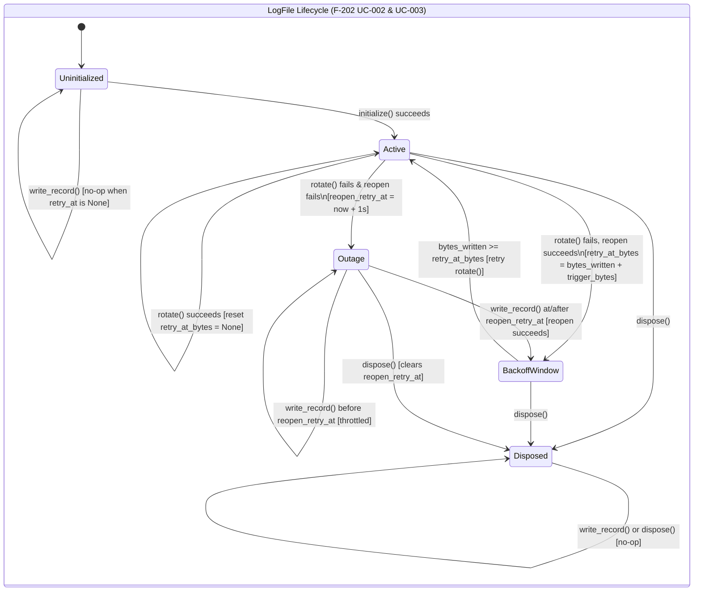
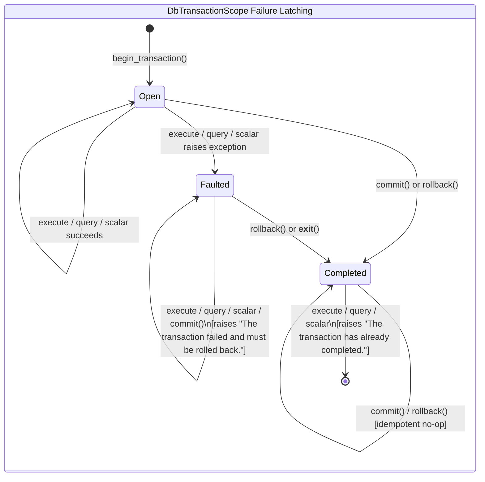

# test: Cross-Language Test Parity and Conformance Alignment (Logging, DbGateway, Dev-Standards)

## Goal Capsule

Bring the unit test suites for `nyssa-ai-logging-py` and `nyssa-ai-logging-ts` and the unit and use-case test suites for `nyssa-ai-dbgateway-py` to behavioral parity with their C# (`nyssa-ai-logging-cs`, `nyssa-ai-dbgateway-cs`) and TypeScript (`nyssa-ai-dbgateway-ts`) counterparts, fix the runtime discrepancies those tests expose, and update `.nyssa-ai/dev-standards/{csharp,python,typescript}.json` so local conformance checks exercise all repository packages rather than only `configuration`. All `nyssa-ai-configuration-{cs,py,ts}` packages remain untouched.

---

## Product Contract

```
product_contract_source: ce-plan-bootstrap
```

### Problem Frame

`NyssaAI.Shared` ships four library families (`result`, `logging`, `dbgateway`, `configuration`) across C#, Python, and TypeScript. While `nyssa-ai-result-{cs,py,ts}` has 1:1 behavioral test coverage across all three languages, `logging` and `dbgateway` have test and behavioral drift:

- In `logging`, `nyssa-ai-logging-cs` tests the full `F-202 UC-002` and `UC-003` log rotation backoff, reopen throttling, post-disposal suppression, and clock-injected retention pruning behaviors (`nyssa-ai-logging-cs/test/unit/LogFileTests.cs`, `nyssa-ai-logging-cs/test/unit/LogFileRotationTests.cs`). `nyssa-ai-logging-py` and `nyssa-ai-logging-ts` omit the failure-backoff, outage-recovery, pre-initialization write, and post-disposal reopen tests, and their `LogFile` implementations hardcode a `1 MiB` retry increment (`_BYTES_PER_MEGABYTE`) instead of `self._rotation_trigger_bytes` / `this.rotationTriggerBytes`.
- In `dbgateway`, `nyssa-ai-dbgateway-cs` and `nyssa-ai-dbgateway-ts` test ad-hoc gateway methods (`execute`, `scalar`, `query_single`, `query`), transaction commit/rollback, transaction failure latching (`"The transaction failed and must be rolled back."`), transactional migration SQL validation (`MigrationSql`), strict SemVer release pin validation, per-dialect SHA-256 fingerprinting (`a53e10b4c4dccd8f675475310dffabc2e66d5f805885948b015c5257cf5fabe1`), and parameter binder validation. `nyssa-ai-dbgateway-py` tests only a basic happy path and lacks the supporting runtime guards.
- In `.nyssa-ai/dev-standards/{csharp,python,typescript}.json`, the `build` and `unit` commands only target `nyssa-ai-configuration-{cs,py,ts}`, leaving `result`, `logging`, and `dbgateway` unexecuted during `check_adoption.py . --run` (and failing `mypy` in `python.json` due to missing `MYPYPATH`/`PYTHONPATH`).

### Requirements

#### Logging Parity (`nyssa-ai-logging-py`, `nyssa-ai-logging-ts`)
- R1. Align `LogFile` rotation failure backoff, pre-initialization write guard, and reopen failure diagnostic text in `nyssa-ai-logging-py` and `nyssa-ai-logging-ts` with `nyssa-ai-logging-cs` and `docs/logging/features/f-202/uc-002-back-off-and-recover-after-failed-log-rotation-or-temporary-outage.md`.
- R2. Expand `LogFile` and `LogFileRotation` unit tests in `nyssa-ai-logging-py` and `nyssa-ai-logging-ts` to cover trigger-threshold boundaries, rotation failure backoff by one trigger window, 1-second reopen retry throttling and recovery, post-dispose suppression during an active outage, pre-initialize no-op writes, idempotent double-dispose, and clock-driven retention pruning.

#### DbGateway Parity (`nyssa-ai-dbgateway-py`)
- R3. Add missing unit-level validation and dialect parity in `nyssa-ai-dbgateway-py` (parameter name validation in `DbParameterBinder`, transactional DDL/DML validation via `MigrationSql`, SemVer and bounds validation in `MigrationCatalog`, and dialect-specific SHA-256 fingerprinting matching C# and TypeScript) together with matching unit tests.
- R4. Add transaction failure latching to `DbTransactionScope` in `nyssa-ai-dbgateway-py` and expand SQLite use-case tests (`test_gateway_sqlite.py` and `test_gateway_migrations.py`) to cover ad-hoc queries/commands/scalars, transaction commit and rollback, latched transaction rejection on subsequent commands and `commit()`, paired + universal migration steps, `verify()`, idempotent re-run, and downgrade to `0.0.0`.

#### Dev-Standards Runner Coverage
- R5. Update `.nyssa-ai/dev-standards/{csharp,python,typescript}.json` command definitions so `check_adoption.py . --run` builds/type-checks and runs unit tests across `result`, `logging`, and `dbgateway` alongside `configuration`.

### Success Criteria

- `nyssa-ai-logging-py` and `nyssa-ai-logging-ts` unit suites test every `LogFile` and `LogFileRotation` scenario present in `nyssa-ai-logging-cs` and pass.
- `nyssa-ai-dbgateway-py` unit and SQLite use-case suites test the same parameter binding, record reading, configuration redaction, migration SQL validation, catalog/fingerprint verification, ad-hoc gateway operations, transaction latching, and migration up/down flows as `nyssa-ai-dbgateway-cs` and `nyssa-ai-dbgateway-ts`, and pass.
- `python .nyssa-ai/dev-standards/typescript/scripts/check_adoption.py . --run` and `python .nyssa-ai/dev-standards/python/scripts/check_adoption.py . --run` exit `0` across all 4 packages in each language.
- In C#, all `result`, `logging`, and `dbgateway` unit tests and structural checks pass under `check_adoption.py . --run` (while `nyssa-ai-configuration-cs` remains untouched per scope exclusion).

### Scope Boundaries

- **Out of scope (explicit user exclusion)**: Any code, test, or structural changes inside `nyssa-ai-configuration-cs`, `nyssa-ai-configuration-py`, or `nyssa-ai-configuration-ts`.
- **Out of scope**: New test cases in `nyssa-ai-result-{cs,py,ts}` (already verified at 1:1 parity across all three languages).
- **Out of scope**: CI workflows, git hooks, or automatic standards execution (prohibited by `AGENTS.md`).

---

## Context and Orientation

### Reference Implementations in Repo

| Package Family | Canonical Reference Files | Target Files to Align |
| :--- | :--- | :--- |
| `logging` | `nyssa-ai-logging-cs/src/FileLogging/LogFile.cs`<br>`nyssa-ai-logging-cs/test/unit/LogFileTests.cs`<br>`nyssa-ai-logging-cs/test/unit/LogFileRotationTests.cs`<br>`docs/logging/features/f-202/uc-002-back-off-and-recover-after-failed-log-rotation-or-temporary-outage.md` | `nyssa-ai-logging-py/src/nyssa_ai_logging/file_logging/log_file.py`<br>`nyssa-ai-logging-py/test/unit/test_log_file.py`<br>`nyssa-ai-logging-py/test/unit/test_log_file_rotation.py`<br>`nyssa-ai-logging-ts/src/fileLogging/LogFile.ts`<br>`nyssa-ai-logging-ts/test/unit/LogFile.test.ts`<br>`nyssa-ai-logging-ts/test/unit/LogFileRotation.test.ts` |
| `dbgateway` (Unit) | `nyssa-ai-dbgateway-cs/src/Migrations/MigrationCatalog.cs`<br>`nyssa-ai-dbgateway-cs/src/Migrations/MigrationSql.cs`<br>`nyssa-ai-dbgateway-ts/test/unit/DbParameterBinder.test.ts`<br>`nyssa-ai-dbgateway-ts/test/unit/DbRecordReader.test.ts`<br>`nyssa-ai-dbgateway-ts/test/unit/DbGatewayConfiguration.test.ts`<br>`nyssa-ai-dbgateway-ts/test/unit/MigrationSql.test.ts`<br>`nyssa-ai-dbgateway-ts/test/unit/MigrationCatalogAndStep.test.ts` | `nyssa-ai-dbgateway-py/src/nyssa_ai_dbgateway/commands/db_parameter_binder.py`<br>`nyssa-ai-dbgateway-py/src/nyssa_ai_dbgateway/migrations/migration_sql.py` (new)<br>`nyssa-ai-dbgateway-py/src/nyssa_ai_dbgateway/migrations/migration_step.py`<br>`nyssa-ai-dbgateway-py/src/nyssa_ai_dbgateway/migrations/migration_catalog.py`<br>`nyssa-ai-dbgateway-py/test/unit/test_parameter_binder.py`<br>`nyssa-ai-dbgateway-py/test/unit/test_record_reader.py`<br>`nyssa-ai-dbgateway-py/test/unit/test_migration_sql.py` (new)<br>`nyssa-ai-dbgateway-py/test/unit/test_migration_catalog_and_step.py` (new) |
| `dbgateway` (Use-Case) | `nyssa-ai-dbgateway-cs/test/unit/Gateway/DbGatewayTests.cs`<br>`nyssa-ai-dbgateway-cs/test/unit/Migrations/MigrationCatalogAndRunnerTests.cs`<br>`nyssa-ai-dbgateway-ts/test/use_case/DbGatewaySqlite.usecase.test.ts`<br>`nyssa-ai-dbgateway-ts/test/use_case/DbGatewayMigration.usecase.test.ts` | `nyssa-ai-dbgateway-py/src/nyssa_ai_dbgateway/gateway/db_transaction_scope.py`<br>`nyssa-ai-dbgateway-py/src/nyssa_ai_dbgateway/migrations/migration_runner.py`<br>`nyssa-ai-dbgateway-py/test/use_case/test_gateway_sqlite.py`<br>`nyssa-ai-dbgateway-py/test/use_case/test_gateway_migrations.py` |
| `dev-standards` | `.nyssa-ai/dev-standards/csharp/scripts/check_adoption.py`<br>`.nyssa-ai/dev-standards/python/scripts/check_adoption.py`<br>`.nyssa-ai/dev-standards/typescript/scripts/check_adoption.py` | `.nyssa-ai/dev-standards/csharp.json`<br>`.nyssa-ai/dev-standards/python.json`<br>`.nyssa-ai/dev-standards/typescript.json` |

---

## Approach and Key Technical Decisions

We will update each target package so its runtime behavior and test suite match the canonical specification and C#/TypeScript sibling implementations, while strictly adhering to the language-specific `dev-standards` structural checkers (`check.py` for Python, `check.mjs` for TypeScript).

### Key Technical Decisions

- KTD1. Update production code in `nyssa-ai-logging-py`, `nyssa-ai-logging-ts`, and `nyssa-ai-dbgateway-py` where adding parity tests exposes missing guards or divergent runtime behavior (session-settled: user-approved — chosen over skipping or weakening the tests: cross-language behavioral parity is the purpose of the test alignment). Covers R1, R3, R4.
- KTD2. Update `.nyssa-ai/dev-standards/{csharp,python,typescript}.json` `build` and `unit` commands to execute across all packages in the repository rather than only `configuration` (session-settled: user-approved — chosen over leaving manifest commands scoped to `configuration`: ensures `check_adoption.py . --run` validates the aligned test suites). Covers R5.
- KTD3. Preserve backward compatibility in `nyssa-ai-dbgateway-py` `MigrationCatalog` and `MigrationStep` while adding C#/TypeScript parity methods: keep `step.compute_fingerprint(dialect="sqlite")` and `MigrationCatalog.fingerprint(step, dialect)` using the dialect-specific SQL formula `{number}:{len(up_sql)}:{up_sql}:{down_len}:{down_sql}` so the paired-step test vector (`a53e10b4c4dccd8f675475310dffabc2e66d5f805885948b015c5257cf5fabe1`) matches C# and TypeScript identically. Covers R3, R4.
- KTD4. Configure `.nyssa-ai/dev-standards/python.json` commands using `python -c` wrapper invocations that set `sys.path` / `MYPYPATH` across all four Python `src` directories before invoking `mypy` and `pytest`, because `check_adoption.py` executes command arrays via `subprocess.run(command, cwd=target, check=False)` without a shell or custom `env` block. Covers R5.

---

## High-Level Technical Design

> *Directional guidance for how `LogFile` state transitions and `DbTransactionScope` failure latching operate across implementations.*





---

## Implementation Units

- [ ] **U1. Align `LogFile` Runtime Recovery and Rotation/Lifecycle Unit Tests in Python (`nyssa-ai-logging-py`)**
  - **Goal**: Fix `LogFile` backoff calculation, pre-initialize write handling, and reopen diagnostic wording in `nyssa-ai-logging-py`, and bring `test_log_file.py` and `test_log_file_rotation.py` to 1:1 parity with `LogFileTests.cs` and `LogFileRotationTests.cs` (per KTD1, R1, R2).
  - **Requirements**: R1, R2 (KTD1)
  - **Dependencies**: None
  - **Files**:
    - Modify: `nyssa-ai-logging-py/src/nyssa_ai_logging/file_logging/log_file.py`
    - Modify: `nyssa-ai-logging-py/test/unit/test_log_file.py`
    - Modify: `nyssa-ai-logging-py/test/unit/test_log_file_rotation.py`
  - **Approach**:
    - In `log_file.py`:
      - Narrow `self._reopen_retry_at` from `object | None = None` to `datetime | None = None`.
      - In `write_record`, when `self._stream is None`, return immediately if `self._reopen_retry_at is None or self._clock.now() < self._reopen_retry_at` (matching `LogFile.cs` line 112 so calling `write_record` before `initialize()` is a no-op).
      - In `_try_reopen_after_failed_rotation`, change `self._rotation_retry_at_bytes = self._bytes_written + _BYTES_PER_MEGABYTE` to `self._rotation_retry_at_bytes = self._bytes_written + self._rotation_trigger_bytes`.
      - Update the reopen failure diagnostic in `_try_reopen_after_failed_rotation` to `f"failed to reopen log file: {ex}"` to match `LogFile.cs` and `F-202 UC-002`.
      - Keep module header comments (`# Responsibility:` and `# Public interface:`) in sync for `check.py`.
    - In `test_log_file.py`, add missing unit tests matching `LogFileTests.cs`:
      - `test_initialize_with_expired_backup_deletes_it_and_keeps_fresh_one`
      - `test_initialize_with_second_writer_on_same_path_both_succeed`
      - `test_write_record_with_structured_fields_and_exception`
      - `test_write_record_before_initialize_does_nothing`
      - `test_write_record_after_dispose_is_ignored_without_throwing`
      - `test_dispose_called_twice_releases_the_file_and_keeps_what_was_written`
    - In `test_log_file_rotation.py`, add missing unit tests matching `LogFileRotationTests.cs`:
      - `test_write_record_rotates_only_once_file_passes_trigger` (comparing 64-byte vs 1 MiB trigger)
      - `test_write_record_when_rotation_fails_reports_once_then_backs_off_by_one_trigger` (placing a directory at `<log_path>.1` so rotation fails while active file reopen succeeds, verifying single stderr report during backoff and a second rotation attempt once another trigger window of bytes is written)
      - `test_write_record_when_rotation_and_reopen_fail_resumes_after_access_is_restored` (blocking `<log_path>.1` and displacing `<log_path>` with a directory during rotation, verifying 1-second reopen retry throttling via `FixedClock`, then removing obstructions and advancing the clock by 1 second to verify automatic recovery)
      - `test_write_record_when_disposed_after_rotation_and_reopen_fail_does_not_reopen` (disposing during outage, removing directory obstruction, advancing clock by 1 minute, and verifying `write_record` neither reopens the file nor emits another stderr failure)
  - **Execution note**: Write or run the new rotation backoff and pre-initialize tests first to observe the failure under the hardcoded `1 MiB` backoff before applying the `log_file.py` fix.
  - **Test scenarios**:
    - Scenario 1: `write_record` called before `initialize()` returns without creating the file or writing to stderr.
    - Scenario 2: With `rotation_trigger_bytes=1024` and a directory occupying `<log_path>.1`, crossing 1024 bytes emits one `"failed to rotate log file"` stderr message, reopens `<log_path>`, suppresses rotation during the next `< 1024` bytes, and retries rotation once another 1024 bytes are written (total 2 stderr messages).
    - Scenario 3: When both rotation and reopen fail (active file path replaced by a directory), writes within 1 second do not re-attempt reopen (`CountReopenFailures == 1`); advancing `FixedClock` by 1 second attempts a second reopen (`CountReopenFailures == 2`); removing the blocking directories and advancing 1 second reopens `<log_path>` and writes the new record.
    - Scenario 4: Disposing `LogFile` while in the failed-reopen outage state clears recovery so advancing `FixedClock` by 1 minute and calling `write_record` does not recreate the file.
    - Scenario 5: Calling `dispose()` twice keeps previously written records intact and releases the file handle so `os.remove(file_path)` succeeds on Windows.
  - **Verification**:
    - Run `pytest nyssa-ai-logging-py/test/unit`, `mypy nyssa-ai-logging-py/src --strict`, and `python .nyssa-ai/dev-standards/python/scripts/check.py nyssa-ai-logging-py/src`.

- [ ] **U2. Align `LogFile` Runtime Recovery and Rotation/Lifecycle Unit Tests in TypeScript (`nyssa-ai-logging-ts`)**
  - **Goal**: Fix `LogFile.ts` backoff calculation, pre-initialize write handling, and reopen diagnostic wording, and bring `LogFile.test.ts` and `LogFileRotation.test.ts` to 1:1 parity with `LogFileTests.cs` and `LogFileRotationTests.cs` (per KTD1, R1, R2).
  - **Requirements**: R1, R2 (KTD1)
  - **Dependencies**: None
  - **Files**:
    - Modify: `nyssa-ai-logging-ts/src/fileLogging/LogFile.ts`
    - Modify: `nyssa-ai-logging-ts/test/unit/LogFile.test.ts`
    - Modify: `nyssa-ai-logging-ts/test/unit/LogFileRotation.test.ts`
  - **Approach**:
    - In `LogFile.ts`:
      - In `writeRecord`, when `this.fd === null`, check `if (this.reopenRetryAtMs === null || this.clock.now().getTime() < this.reopenRetryAtMs) { return; }` before calling `this.tryReopenAfterFailedRotation()` so writing before `initialize()` is a safe no-op.
      - In `tryReopenAfterFailedRotation`, change `this.rotationRetryAtBytes = this.bytesWritten + BYTES_PER_MEGABYTE;` to `this.rotationRetryAtBytes = this.bytesWritten + this.rotationTriggerBytes;`.
      - Update the reopen error diagnostic in `tryReopenAfterFailedRotation` to `` `failed to reopen log file: ${message}` ``.
    - In `LogFile.test.ts`, add missing unit tests matching `LogFileTests.cs`:
      - `initialize_withExpiredBackup_deletesItAndKeepsFreshOne`
      - `initialize_withSecondWriterOnSamePath_bothSucceed`
      - `writeRecord_withStructuredFieldsAndException_writesAllFields`
      - `writeRecord_beforeInitialize_doesNothing`
      - `writeRecord_afterDispose_isIgnoredWithoutThrowing`
      - `dispose_calledTwice_releasesTheFileAndKeepsWhatWasWritten`
    - In `LogFileRotation.test.ts`, add missing unit tests matching `LogFileRotationTests.cs`:
      - `writeRecord_rotatesOnlyOnceFilePassesTrigger`
      - `writeRecord_whenRotationFails_reportsOnceThenBacksOffByOneTrigger`
      - `writeRecord_whenRotationAndReopenFail_resumesAfterAccessIsRestored`
      - `writeRecord_whenDisposedAfterRotationAndReopenFail_doesNotReopen`
  - **Execution note**: Add the new rotation backoff and pre-initialize tests in `LogFileRotation.test.ts` and `LogFile.test.ts` first, verify they fail against the current `BYTES_PER_MEGABYTE` backoff, then apply the `LogFile.ts` fixes.
  - **Test scenarios**:
    - Scenario 1: `writeRecord` called on an uninitialized `LogFile` does not create the file or emit stderr diagnostics.
    - Scenario 2: With `rotationTriggerBytes = 1024` and `<filePath>.1` occupied by a directory, writing past 1024 bytes logs one rotation failure to stderr, keeps writing to the reopened active file without stderr spam while below the next 1024-byte trigger window, and logs a second rotation failure once another 1024 bytes are written.
    - Scenario 3: When active file reopen also fails (because `<filePath>` was displaced by a directory), writes before 1 second elapses on `FixedClock` are throttled; advancing `FixedClock` by 1 second triggers a retry; removing the directory and advancing 1 second restores logging to `<filePath>`.
    - Scenario 4: Calling `dispose()` during a reopen outage prevents any reopen attempt after advancing `FixedClock` by 60 seconds.
    - Scenario 5: Calling `dispose()` twice preserves existing log content and allows `fs.unlinkSync(scope.filePath)` to succeed on Windows.
  - **Verification**:
    - Run `npm --prefix nyssa-ai-logging-ts run build`, `npm --prefix nyssa-ai-logging-ts test`, and `node .nyssa-ai/dev-standards/typescript/scripts/check.mjs nyssa-ai-logging-ts/src`.

- [ ] **U3. Add `MigrationSql` Validation, Catalog/Binder Guards, and Unit Test Parity in `nyssa-ai-dbgateway-py`**
  - **Goal**: Bring `nyssa-ai-dbgateway-py` unit-level validation and unit tests (`test_parameter_binder.py`, `test_record_reader.py`, `test_migration_sql.py`, `test_migration_catalog_and_step.py`) to parity with `nyssa-ai-dbgateway-cs` and `nyssa-ai-dbgateway-ts` (per KTD1, KTD3, R3).
  - **Requirements**: R3 (KTD1, KTD3)
  - **Dependencies**: None
  - **Files**:
    - Create: `nyssa-ai-dbgateway-py/src/nyssa_ai_dbgateway/migrations/migration_sql.py`
    - Modify: `nyssa-ai-dbgateway-py/src/nyssa_ai_dbgateway/migrations/migration_step.py`
    - Modify: `nyssa-ai-dbgateway-py/src/nyssa_ai_dbgateway/migrations/migration_catalog.py`
    - Modify: `nyssa-ai-dbgateway-py/src/nyssa_ai_dbgateway/migrations/migration_runner.py`
    - Modify: `nyssa-ai-dbgateway-py/src/nyssa_ai_dbgateway/commands/db_parameter_binder.py`
    - Modify: `nyssa-ai-dbgateway-py/src/nyssa_ai_dbgateway/__init__.py`
    - Modify: `nyssa-ai-dbgateway-py/test/unit/test_parameter_binder.py`
    - Modify: `nyssa-ai-dbgateway-py/test/unit/test_record_reader.py`
    - Create: `nyssa-ai-dbgateway-py/test/unit/test_migration_sql.py`
    - Create: `nyssa-ai-dbgateway-py/test/unit/test_migration_catalog_and_step.py`
  - **Approach**:
    - Create `migration_sql.py` implementing `MigrationSql.is_transactional(sql: str | None) -> bool` with the same lexical scanner as `MigrationSql.cs` and `MigrationSql.ts` (rejecting empty/whitespace SQL, unclosed block comments or quotes, nested block comments, `E'...'` escapes, and top-level `BEGIN`, `START`, `COMMIT`, `END`, `ROLLBACK`, `ABORT`, `SAVEPOINT`, `RELEASE`, `VACUUM`, `ATTACH`, `DETACH`, `PRAGMA`, `PREPARE`, `SET`, `RESET`, `DISCARD` while allowing `CREATE [TEMP|TEMPORARY] TRIGGER ... BEGIN ... END`).
    - Update `MigrationStep.compute_fingerprint(self, dialect: DbDialect = "sqlite") -> str` and add `MigrationCatalog.fingerprint(step: MigrationStep, dialect: DbDialect) -> str` so the fingerprint is computed from `up_sql = step.get_up_sql(dialect)` and `down_sql = step.get_down_sql(dialect)` via `f"{step.number}:{len(up_sql)}:{up_sql}:{len(down_sql) if down_sql is not None else -1}:{down_sql or ''}"` (matching `MigrationCatalog.cs` line 91 and `MigrationCatalog.ts` line 105). Update `MigrationRunner` calls to pass `self._provider.dialect` when computing fingerprints.
    - Update `MigrationCatalog.__init__` / `MigrationCatalog.create` to validate:
      - Contiguous step numbers starting at `1`.
      - `MigrationSql.is_transactional` on defined `up_sql`, `sqlite_up_sql`, `postgres_up_sql`, and any non-null `down_sql` / `sqlite_down_sql` / `postgres_down_sql`.
      - When `releases` are provided, validate each `MigrationReleasePin.release` against the canonical SemVer regex, verify `0 <= pin.number <= len(steps)`, and reject duplicate release pins. Add `resolve(release: str) -> int` alias alongside `resolve_target_version`.
    - Update `DbParameterBinder.add` to strip leading `@` or `:` and raise `ValueError("Parameter name cannot be empty.")` when the resulting name is empty or whitespace-only.
    - Expand `test_parameter_binder.py` and `test_record_reader.py`, and add `test_migration_sql.py` and `test_migration_catalog_and_step.py` to mirror `nyssa-ai-dbgateway-ts/test/unit/*.test.ts`.
  - **Test scenarios**:
    - Scenario 1: `MigrationSql.is_transactional` returns `True` for `CREATE TABLE`, `CREATE INDEX` with line/block comments, `ALTER TABLE`, `DROP TABLE`, and `CREATE TRIGGER ... BEGIN ... END`, and returns `False` for `BEGIN TRANSACTION`, `START TRANSACTION`, `COMMIT`, `ROLLBACK`, `VACUUM`, `PRAGMA`, `SET search_path`, unclosed comments/quotes, and empty/whitespace strings.
    - Scenario 2: `MigrationCatalog.fingerprint(step, "sqlite")` on the paired step `(1, "CREATE TABLE items (id TEXT PRIMARY KEY, active INTEGER NOT NULL)", "CREATE TABLE items (id UUID PRIMARY KEY, active BOOLEAN NOT NULL)", "DROP TABLE items", "DROP TABLE items")` returns `"a53e10b4c4dccd8f675475310dffabc2e66d5f805885948b015c5257cf5fabe1"`.
    - Scenario 3: `MigrationCatalog.create` raises `ValueError` on non-contiguous steps, non-SemVer release pin `"v1.0"`, out-of-range release pin step `99`, duplicate release pins, or step SQL containing `BEGIN;` / `COMMIT;`.
    - Scenario 4: `DbParameterBinder.add` raises `ValueError` on `""`, `"   "`, and `"@"`, and `to_postgres_values` raises `ValueError` when a referenced SQL parameter is missing.
    - Scenario 5: `DbRecordReader` coerces booleans (`1`, `0`, `"true"`, `True`), UUID strings and raw bytes, ints, floats, `Decimal`, ISO-8601 `Z` timestamps, `bytes`/`bytearray`, and `is_null`, and supports case-insensitive column names and integer ordinals.
  - **Verification**:
    - Run `pytest nyssa-ai-dbgateway-py/test/unit`, `mypy nyssa-ai-dbgateway-py/src --strict`, and `python .nyssa-ai/dev-standards/python/scripts/check.py nyssa-ai-dbgateway-py/src`.

- [ ] **U4. Add Transaction Failure Latching and Expand SQLite Use-Case Tests in `nyssa-ai-dbgateway-py`**
  - **Goal**: Add transaction failure latching to `DbTransactionScope` and expand `test_gateway_sqlite.py` and `test_gateway_migrations.py` in `nyssa-ai-dbgateway-py/test/use_case/` to match `DbGatewaySqlite.usecase.test.ts`, `DbGatewayMigration.usecase.test.ts`, `DbGatewayTests.cs`, and `MigrationCatalogAndRunnerTests.cs` (per KTD1, KTD3, R4).
  - **Requirements**: R4 (KTD1, KTD3)
  - **Dependencies**: U3
  - **Files**:
    - Modify: `nyssa-ai-dbgateway-py/src/nyssa_ai_dbgateway/gateway/db_transaction_scope.py`
    - Modify: `nyssa-ai-dbgateway-py/test/use_case/test_gateway_sqlite.py`
    - Modify: `nyssa-ai-dbgateway-py/test/use_case/test_gateway_migrations.py`
  - **Approach**:
    - In `db_transaction_scope.py`:
      - Add `self._failed = False` alongside `self._completed = False`, plus a private `_ensure_active(self) -> None` helper.
      - Before executing any statement in `execute`, `scalar`, `query`, or `commit`, call `_ensure_active()`: if `self._completed` is `True`, raise `RuntimeError("The transaction has already completed.")`; if `self._failed` is `True`, raise `RuntimeError("The transaction failed and must be rolled back.")`.
      - In the `except Exception:` blocks of `execute`, `scalar`, and `query` (and `commit`), set `self._failed = True` before re-raising.
      - In `rollback()`, allow rollback when `not self._completed` (even when `self._failed` is `True`), setting `self._completed = True`.
      - In `__exit__`, check `if not self._completed:` before finalizing, and call `self.rollback()` when `exc_type is not None or self._failed` (calling `self.commit()` only when `not self._failed`).
    - In `test_gateway_sqlite.py`, add use-case tests matching `DbGatewaySqlite.usecase.test.ts` and `DbGatewayTests.cs`:
      - `test_sqlite_typed_command_and_query` and `test_sqlite_transaction_rollback` (existing tests preserved)
      - `test_sqlite_ad_hoc_execute_scalar_query_single_and_query`
      - `test_sqlite_execute_transaction_commits_on_success_and_rolls_back_on_error`
      - `test_sqlite_begin_transaction_latches_failure_and_blocks_subsequent_commands_and_commit`
    - In `test_gateway_migrations.py`, expand use-case tests to match `DbGatewayMigration.usecase.test.ts` and `MigrationCatalogAndRunnerTests.cs`:
      - `test_sqlite_migration_upgrade_and_downgrade` (existing test preserved)
      - `test_migration_paired_and_universal_steps_verify_idempotent_rerun_and_downgrade_to_zero` (using paired step 1 + universal step 2 and SemVer pins `0.0.0`, `1.0.0`, `1.1.0`, verifying `migrate("1.1.0")` applies 2 steps, `verify()` succeeds, re-running `migrate("1.1.0")` applies 0 steps, downgrading `migrate("1.0.0")` drops the step-2 index while keeping step-1 table data, and downgrading `migrate("0.0.0")` reverts to version `0` and drops the table)
      - `test_migration_corrupted_fingerprint_raises_value_error_on_verify_and_migrate`
  - **Execution note**: Write the latched-transaction test in `test_gateway_sqlite.py` first to confirm it fails without `_failed` state tracking in `DbTransactionScope`, then implement `_ensure_active` and `_failed` latching.
  - **Test scenarios**:
    - Scenario 1: Ad-hoc `gateway.execute`, `gateway.scalar`, `gateway.query_single`, and `gateway.query` with `@`-prefixed named parameters insert, count, fetch single row, and list rows against a file-backed SQLite database.
    - Scenario 2: `gateway.execute_transaction` commits inserted rows when the callback succeeds, and rolls back inserted rows when a later statement in the callback fails.
    - Scenario 3: Inside `gateway.begin_transaction()`, after a statement fails with a SQLite syntax/table error, any subsequent `tx.execute(...)` or `tx.commit()` raises `RuntimeError` matching `"The transaction failed and must be rolled back."`, and `tx.rollback()` cleanly rolls back the first statement's insert.
    - Scenario 4: Running `MigrationRunner` with paired step 1 and universal step 2 migrates to `"1.1.0"` (`current_version == 2`, `len(applied_steps) == 2`), passes `runner.verify()`, returns `len(applied_steps) == 0` on idempotent re-run, downgrades to `"1.0.0"` (`current_version == 1`, `len(reverted_steps) == 1`) while preserving step-1 table rows, and downgrades to `"0.0.0"` (`current_version == 0`).
    - Scenario 5: Tampering with ` fingerprint ` in `__nyssa_migrations` causes both `runner.verify()` and `runner.migrate_up()` to raise `ValueError`.
  - **Verification**:
    - Run `pytest nyssa-ai-dbgateway-py/test/unit nyssa-ai-dbgateway-py/test/use_case`, `mypy nyssa-ai-dbgateway-py/src --strict`, and `python .nyssa-ai/dev-standards/python/scripts/check.py nyssa-ai-dbgateway-py/src`.

- [ ] **U5. Update `.nyssa-ai/dev-standards/{csharp,python,typescript}.json` Commands to Cover All Repository Packages**
  - **Goal**: Update the pinned local command manifests so `check_adoption.py . --run` builds/type-checks and runs unit tests across `result`, `logging`, and `dbgateway` as well as `configuration` (per KTD2, KTD4, R5).
  - **Requirements**: R5 (KTD2, KTD4)
  - **Dependencies**: U1, U2, U3, U4
  - **Files**:
    - Modify: `.nyssa-ai/dev-standards/csharp.json`
    - Modify: `.nyssa-ai/dev-standards/python.json`
    - Modify: `.nyssa-ai/dev-standards/typescript.json`
  - **Approach**:
    - In `.nyssa-ai/dev-standards/csharp.json`:
      - Reorder `source_roots` so `nyssa-ai-result-cs/src`, `nyssa-ai-logging-cs/src`, and `nyssa-ai-dbgateway-cs/src` run before `nyssa-ai-configuration-cs/src` (so `Checker.csproj` validates all three in-scope packages before encountering pre-existing out-of-scope violations in `configuration-cs`).
      - Update `commands.unit` to use `"cwd": "."` with a single `python -c` `argv` that runs `dotnet test --project <path>` sequentially across `nyssa-ai-result-cs/test/unit/NyssaAI.Result.Tests.csproj`, `nyssa-ai-logging-cs/test/unit/NyssaAI.Logging.Tests.csproj`, `nyssa-ai-dbgateway-cs/test/unit/NyssaAI.DbGateway.Tests.csproj`, and `nyssa-ai-configuration-cs/test/unit/NyssaAI.Configuration.Tests.csproj`.
      - Update `commands.use_case` to use `"cwd": "."` with a single `python -c` `argv` that runs `dotnet test --project <path>` sequentially across `nyssa-ai-result-cs/test/use_case/NyssaAI.Result.UseCaseTests.csproj`, `nyssa-ai-logging-cs/test/use_case/NyssaAI.Logging.UseCaseTests.csproj`, and `nyssa-ai-configuration-cs/test/use_case/NyssaAI.Configuration.UseCaseTests.csproj`.
    - In `.nyssa-ai/dev-standards/python.json`:
      - Update `commands.build` to run `mypy --strict` across `nyssa-ai-result-py/src`, `nyssa-ai-configuration-py/src`, `nyssa-ai-logging-py/src`, and `nyssa-ai-dbgateway-py/src` via a `python -c` invocation that sets `os.environ["MYPYPATH"]` to the four `src` directories so cross-package imports (`nyssa_ai_result`) resolve cleanly from the repo root.
      - Update `commands.unit` to run `pytest` across `nyssa-ai-result-py/test/unit`, `nyssa-ai-configuration-py/test/unit`, `nyssa-ai-logging-py/test/unit`, and `nyssa-ai-dbgateway-py/test/unit` via a `python -c` invocation that prepends the four `src` directories to `sys.path`.
      - Update `commands.use_case` to run `pytest` across the non-Docker use-case suites (`nyssa-ai-result-py/test/use_case`, `nyssa-ai-configuration-py/test/use_case`, `nyssa-ai-logging-py/test/use_case`, and `nyssa-ai-dbgateway-py/test/use_case -k "not postgres"`).
    - In `.nyssa-ai/dev-standards/typescript.json`:
      - Update `commands.build` to use `"cwd": "."` with a single `node -e` `argv` that runs `npm --prefix <pkg> run build` sequentially across `nyssa-ai-result-ts`, `nyssa-ai-configuration-ts`, `nyssa-ai-logging-ts`, and `nyssa-ai-dbgateway-ts`.
      - Update `commands.unit` to use `"cwd": "."` with a single `node -e` `argv` that runs `npm --prefix <pkg> run test:unit` sequentially across `nyssa-ai-result-ts`, `nyssa-ai-configuration-ts`, `nyssa-ai-logging-ts`, and `nyssa-ai-dbgateway-ts`.
      - Update `commands.use_case` to use `"cwd": "."` with a single `node -e` `argv` that runs `npm --prefix <pkg> run test:usecase` sequentially across `nyssa-ai-result-ts`, `nyssa-ai-configuration-ts`, `nyssa-ai-logging-ts`, and `nyssa-ai-dbgateway-ts`.
  - **Test scenarios**:
    - Scenario 1: `python .nyssa-ai/dev-standards/typescript/scripts/check_adoption.py . --run` builds all 4 TypeScript packages, runs all 4 TypeScript unit test suites, runs `check.mjs` across all 4 `source_roots`, and exits `0`.
    - Scenario 2: `python .nyssa-ai/dev-standards/python/scripts/check_adoption.py . --run` runs `mypy --strict` across all 4 Python packages, runs all 4 Python unit test suites, runs `check.py` across all 4 `source_roots`, and exits `0`.
    - Scenario 3: `python .nyssa-ai/dev-standards/csharp/scripts/check_adoption.py . --run` builds `NyssaAI.Shared.slnx`, runs all 4 C# unit test projects (all passing), and runs `Checker.csproj` across `result-cs`, `logging-cs`, and `dbgateway-cs` (passing with 0 violations) before exiting non-zero on `configuration-cs`'s pre-existing out-of-scope `CS-FILE` violations.
  - **Verification**:
    - Run `python .nyssa-ai/dev-standards/typescript/scripts/check_adoption.py . --run`.
    - Run `python .nyssa-ai/dev-standards/python/scripts/check_adoption.py . --run`.
    - Run the C# unit test and `Checker.csproj` commands in Verification Contract item 3.

---

## Verification Contract

1. **Python Structural, Type, Unit, and Use-Case Verification**:
   - `python .nyssa-ai/dev-standards/python/scripts/check_adoption.py . --run` -> exits `0`.
   - `pytest nyssa-ai-dbgateway-py/test/use_case/test_gateway_sqlite.py nyssa-ai-dbgateway-py/test/use_case/test_gateway_migrations.py` -> exits `0`.
2. **TypeScript Structural, Build, Unit, and Use-Case Verification**:
   - `python .nyssa-ai/dev-standards/typescript/scripts/check_adoption.py . --run` -> exits `0`.
3. **C# Build, Unit, and Non-Configuration Structural Verification**:
   - `dotnet test --project nyssa-ai-result-cs/test/unit/NyssaAI.Result.Tests.csproj` -> exits `0`.
   - `dotnet test --project nyssa-ai-logging-cs/test/unit/NyssaAI.Logging.Tests.csproj` -> exits `0`.
   - `dotnet test --project nyssa-ai-dbgateway-cs/test/unit/NyssaAI.DbGateway.Tests.csproj` -> exits `0`.
   - `dotnet run --project .nyssa-ai/dev-standards/csharp/scripts/Checker/Checker.csproj -- nyssa-ai-result-cs/src` -> exits `0`.
   - `dotnet run --project .nyssa-ai/dev-standards/csharp/scripts/Checker/Checker.csproj -- nyssa-ai-logging-cs/src` -> exits `0`.
   - `dotnet run --project .nyssa-ai/dev-standards/csharp/scripts/Checker/Checker.csproj -- nyssa-ai-dbgateway-cs/src` -> exits `0`.
4. **Scope Boundary Verification**:
   - `git status --short nyssa-ai-configuration-cs nyssa-ai-configuration-py nyssa-ai-configuration-ts` -> empty output (no files modified in any `configuration` package).

---

## Risks and Dependencies

- **Windows File-Locking Semantics in `LogFileRotation` Tests**: On Windows, `os.replace` / `fs.renameSync` fails when the target path is a directory, which is the same deterministic mechanism `LogFileRotationTests.cs` uses to force rotation and reopen failures without elevated permissions. All temporary directories and displaced files created in tests must be cleaned up in `finally` blocks so test runs never leak temp folders.
- **Python `MigrationCatalog.create` Backward Compatibility**: Existing Python tests call `MigrationCatalog([step1, step2])` without `releases` (`releases: Sequence[MigrationReleasePin] | None = None`). Keeping `releases` optional when `None` while enforcing strict SemVer and range validation on all provided `MigrationReleasePin` items preserves backward compatibility with existing callers while satisfying all new `MigrationCatalogAndStep` unit tests.

---

## Definition of Done

- [ ] U1–U5 are implemented with all unit and SQLite use-case tests passing across C#, Python, and TypeScript.
- [ ] `python .nyssa-ai/dev-standards/python/scripts/check_adoption.py . --run` and `python .nyssa-ai/dev-standards/typescript/scripts/check_adoption.py . --run` exit `0`.
- [ ] `nyssa-ai-result-cs`, `nyssa-ai-logging-cs`, and `nyssa-ai-dbgateway-cs` pass all unit tests and C# `Checker.csproj` structural checks.
- [ ] Zero files under `nyssa-ai-configuration-{cs,py,ts}` are modified.
