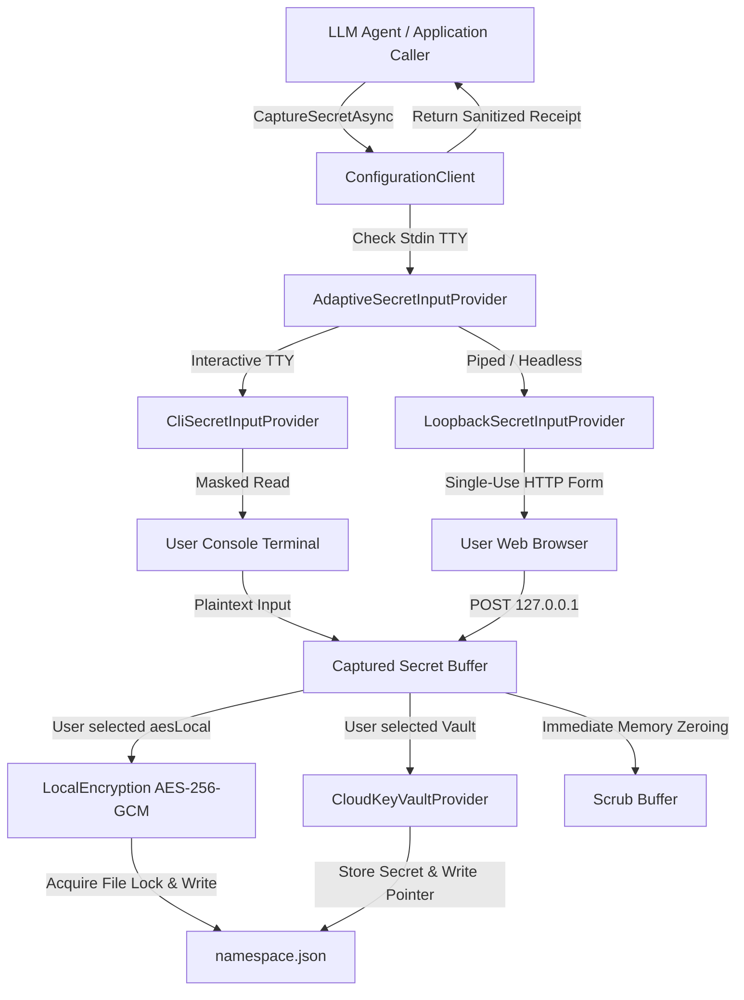
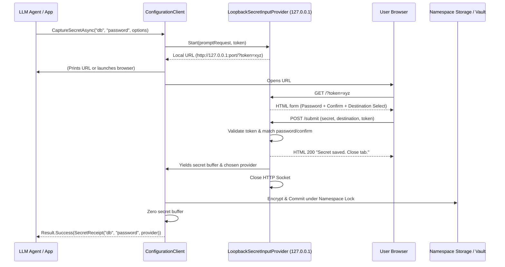
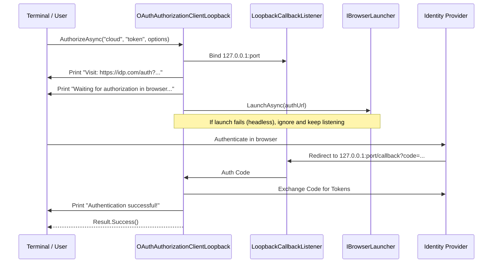

# feat: Out-of-Band Secret Capture and Interactive OAuth CLI Experience

## Goal Capsule

Enable `ConfigurationClient` across C#, Python, and TypeScript to capture sensitive secrets (passwords, tokens, API keys) out-of-band from the user without exposing plaintext credentials to LLM caller context, logs, or prompt histories, and enrich existing OAuth PKCE loopback authorization with terminal-visible URL output and status feedback matching modern CLI tools.

- **Objective:** Users and automated agent orchestrators can securely store secrets into local encrypted storage (`aesLocal`) or cloud vaults (e.g., Bitwarden Secrets Manager `bws`, Azure Key Vault) via an adaptive interactive prompt (masked CLI console or local loopback browser form), returning only an unprivileged metadata receipt to the caller, while OAuth sign-in provides terminal-visible URLs and resilient loopback waiting for headless/SSH CLI workflows.
- **Means:** Introduce pluggable `ISecretInputProvider` and `IConfigurationSecretWriter` (`CaptureSecretAsync`) alongside an upgraded `OAuthAuthorizationClientLoopback` across `nyssa-ai-configuration-{cs,py,ts}`.
- **Product Authority:** Covers `nyssa-ai-configuration-cs`, `nyssa-ai-configuration-py`, and `nyssa-ai-configuration-ts`. Underlying crypto schemes (AES-256-GCM FormatVersion 2) and manifest schemas remain unchanged.
- **Execution Profile:** Staged multi-package delivery across .NET, Python, and TypeScript. Waits on: none.
- **Open Blockers:** None.

---

## Product Contract

```
product_contract_source: ce-brainstorm
```

Product Contract preservation: Product Contract unchanged.

### Summary

When an LLM agent or automated orchestrator assists in configuring an application, asking the user for a secret exposes that plaintext credential to the model's prompt context, transcript logs, and inference history.

We are introducing a secure secret-capture capability directly on `ConfigurationClient` across C#, Python, and TypeScript. It prompts the user out-of-band via a pluggable input provider (adaptive between a masked CLI terminal prompt and a single-use local web loopback form), allows the user to confirm or choose storage between local `aesLocal` encryption and configured cloud vaults, commits the secret directly into storage, and returns only a sanitized metadata receipt (`namespace`, `key`, `provider`, `success`) to the caller. Concurrently, existing OAuth PKCE loopback authorization (`F-202`) is enhanced with console-visible URLs and terminal status feedback so users in headless or SSH CLI environments can easily authenticate via external browsers.

### Problem Frame

Today, `nyssa-ai-configuration-*` supports writing values via `SetAsync(namespace, key, value, provider)` where the caller must supply the plaintext `value`. In LLM-assisted workflows, this forces the agent to prompt the user in chat, permanently leaking sensitive API keys, database credentials, or vault master tokens into model context windows, prompt caches, and audit logs.

Additionally, while `F-202` (`AuthorizeAsync`) performs browser-based PKCE loops to store OAuth tokens without passing tokens to the caller, it invokes the OS browser silently via `Process.Start` or `xdg-open` without printing the authorization URL to the controlling terminal. In remote CLI, SSH, or containerized workflows where browser auto-launch fails or is unavailable, the user receives no clickable URL or progress status, leading to hangs or timeouts.

### Key Decisions

- `session-settled: input-provider-architecture` — Pluggable input provider architecture (`ISecretInputProvider` / `SecretInputHandler`) supporting both masked CLI console input and local web loopback form over fixed single-mode solutions. Governs R2.
- `session-settled: adaptive-environment-selection` — Adaptive default selection: when an interactive terminal (TTY) is attached, use masked console input; when headless, non-interactive, or piped (e.g., inside an LLM subprocess), automatically fall back to an ephemeral web loopback server. Callers may explicitly override this behavior. Governs R3.
- `session-settled: destination-and-vault-selection` — Caller can supply target namespace, key, and optional preferred provider, but the interactive UI (CLI prompt or Web form) allows the user to confirm or select the target destination (local `aesLocal` or any loaded cloud vault). Governs R4.
- `session-settled: sanitized-receipt-feedback` — Caller/LLM receives only a sanitized metadata receipt (`namespace`, `key`, `provider`, `status`); plaintext secrets and masked snippets are strictly excluded from the return payload and logs. Governs R6.
- `session-settled: confirmation-prompt-frequency` — Interactive input defaults to prompting twice to verify/confirm match against typos, but allows callers to configure single entry (`confirm: false`). Governs R5.
- `session-settled: oauth-cli-experience` — Enhance `AuthorizeAsync` to output the authorization URL to the controlling terminal/console and provide status messages ("Waiting for authorization...", "Authorization complete"), preserving full headless and SSH usability. Governs R7, R8.
- `session-settled: programmatic-api-consistency` — Feature is integrated directly into `ConfigurationClient` / `IConfigurationWriter` across C#, Python, and TypeScript, matching existing library idioms. Governs R1.

### Scope Boundaries

- **In Scope:**
  - Pluggable secret input abstractions across C#, Python, and TypeScript.
  - Interactive masked CLI console provider (`Console.ReadKey(intercept: true)` in C#, `getpass` in Python, raw mode readline in TypeScript).
  - Single-use local web loopback HTTP form provider binding `127.0.0.1` on an ephemeral port with a cryptographically secure random session token.
  - Immediate zeroing/memory hygiene of plaintext secret buffers after storage/encryption.
  - Integration with existing `LocalEncryption` (`aesLocal` AES-256-GCM) and `ICloudKeyVault` / `CloudKeyVaultProvider`.
  - Console URL and status emission in `AuthorizeAsync` / `AuthorizeProviderAsync` / `ReauthorizeAsync`.
  - Unit and integration tests across all three packages verifying secret isolation and receipt generation without memory/log leakage.
- **Out of Scope:**
  - Remote cloud relays or external SaaS webhooks for secret capture.
  - Displaying or exporting decrypted secrets back to the caller or LLM.
  - Modifying the underlying manifest schema or encryption cipher formats (FormatVersion 2 AES-256-GCM remains standard).

### Requirements

#### Secret Ingestion API & Lifecycle

- **R1. Programmatic Secret Capture API**: `ConfigurationClient` must expose an async method (`CaptureSecretAsync` / `capture_secret` / `captureSecret`) accepting target `namespace`, `key`, optional `promptMessage`, optional `preferredProvider`, optional `confirm` flag (defaulting to `true`), and optional timeout/cancellation token.
- **R2. Pluggable Secret Input Providers**: The package must define an abstraction (`ISecretInputProvider`) with two built-in implementations:
  - *CLI Provider*: Reads un-echoed characters directly from the controlling terminal/TTY.
  - *Web Loopback Provider*: Binds an ephemeral port on `127.0.0.1`, generates a one-time session token, serves a minimal HTML form, captures the secret via POST, and immediately terminates.
- **R3. Adaptive Provider Selection**: By default, the client detects whether standard input is an attached interactive TTY. If interactive, it uses the CLI provider; if piped or headless, it uses the Web Loopback provider. Callers can override provider selection via options.
- **R4. Destination Confirmation & Selection**: The interactive prompt (both CLI and Web form) must present the available storage targets: local encryption (`aesLocal`) and any configured cloud vaults (e.g., `bws`, `azure-key-vault`). If a preferred provider was passed by the caller, it is pre-selected, but the user may override it.
- **R5. Double-Entry Verification**: By default, the user is prompted to enter the secret twice. If values do not match, the prompt allows retry or returns an error. Callers can set `confirm: false` to allow single entry.
- **R6. Memory Hygiene & Zero Plaintext Leakage**:
  - The plaintext secret must never be logged, included in exception messages, or returned to the caller.
  - The secret buffer must be zeroed/cleared from memory immediately after cipher execution or HTTP dispatch to the vault.
  - The method must return a `SecretReceipt` containing only `namespace`, `key`, `provider`, and `status`.

#### OAuth CLI Enhancement

- **R7. Console URL & Status Feedback for OAuth**: `AuthorizeAsync`, `AuthorizeProviderAsync`, and `ReauthorizeAsync` must write the authorization URL to the controlling terminal/console before awaiting loopback callback, enabling users in headless, remote SSH, or containerized environments to copy and open the URL manually.
- **R8. Non-Blocking Browser Launch**: Browser launch failures (e.g., missing `xdg-open` or headless environment) must not terminate the authorization flow; the loopback listener continues waiting for the callback while the console URL remains available for manual user navigation.

### User Experience & Flows

#### Flow 1: CLI Masked Secret Prompt (Interactive Terminal)
1. Agent/App calls `config.CaptureSecretAsync("db", "password", promptMessage: "Enter database password")`.
2. Client detects active TTY and displays prompt to console:
   ```text
   Enter database password for db:password:
   [1] Local encrypted (aesLocal) [Default]
   [2] Bitwarden Secrets Manager (bws)
   Select storage destination [1]: 1
   Enter secret: *********
   Confirm secret: *********
   ```
3. Client encrypts password via `aesLocal` (AES-256-GCM bound to `db:password` AAD), saves to `<namespace>.json`, and wipes plaintext from memory.
4. Client returns `Result.Success(new SecretReceipt("db", "password", "aesLocal"))` to the caller.

#### Flow 2: Web Loopback Secret Prompt (Piped / Agent Subshell / Headless)
1. Agent/App running in LLM tool subshell invokes `CaptureSecretAsync`.
2. Client detects stdin is non-interactive/piped and spins up loopback server on `http://127.0.0.1:54321/?session=<crypto-random-token>`.
3. Client launches default browser (or prints the local URL to the terminal/stdout).
4. User opens the browser tab, sees a clean minimal prompt showing namespace and key, selects destination (Local vs Vault), enters password twice, and clicks Submit.
5. Loopback server receives payload, stores secret into configured destination, serves confirmation page ("Secret saved. Close this tab."), and terminates immediately.
6. Client wipes plaintext from memory and returns `Result.Success(SecretReceipt)` to agent.

#### Flow 3: Enhanced OAuth Login in CLI
1. Caller executes `AuthorizeAsync("cloud", "token", oauthOptions)`.
2. Client starts loopback callback listener on `127.0.0.1`.
3. Client outputs to terminal:
   ```text
   Please visit the following URL to log in:
   https://auth.example.com/oauth/authorize?client_id=...&redirect_uri=http%3A%2F%2F127.0.0.1%3A...
   Waiting for authentication in browser...
   ```
4. Client attempts system browser launch (ignores failure gracefully if headless).
5. User completes login in browser; loopback listener captures auth code, exchanges for tokens, and seals tokens locally.
6. Client emits: `"Authentication successful! Stored credentials under provider 'oauth'."` and returns success.

### Success Criteria

- **C1. Complete LLM Secrecy**: At no point in either CLI or Web capture does the plaintext secret appear in caller memory, return values, log streams, or exception stacks.
- **C2. Storage Parity**: Captured secrets can be stored into either `"aesLocal"` or any configured `ICloudKeyVault` with identical behavioral envelopes as standard `SetAsync`.
- **C3. Cross-Language Parity**: All capabilities are identically supported across C# (`NyssaAI.Configuration`), Python (`nyssa-ai-configuration`), and TypeScript (`@nyssa-ai/configuration`).
- **C4. Headless & SSH Resilience**: Both secret capture (via Web loopback) and OAuth authorization (via console URL display) function seamlessly in non-interactive/remote environments without freezing or failing.

---

## Planning Contract

### Summary

The implementation enriches `ConfigurationClient` across C#, Python, and TypeScript with secret-capturing capabilities that guarantee zero plaintext leakage to LLM orchestrators. It adds a dedicated `IConfigurationSecretWriter` surface, creates an extensible `ISecretInputProvider` engine (supporting masked TTY, loopback HTTP web form, and adaptive detection), and upgrades `OAuthAuthorizationClientLoopback` to output URLs to the terminal with non-blocking browser fallback.

### Key Technical Decisions

- **KTD1: Dedicated Secret Writer Interface (`IConfigurationSecretWriter`)** — Matches the existing separation in `IConfigurationOAuthWriter`. `ConfigurationClient` implements `IConfigurationSecretWriter`, keeping secret-capturing semantics separate from standard `IConfigurationWriter.SetAsync` where the caller already possesses the plaintext. (Cites R1).
- **KTD2: Pluggable Input Engine (`ISecretInputProvider`) with Adaptive TTY Detection** — An abstraction `ISecretInputProvider` accepts a `SecretPromptRequest` and yields a `CapturedSecret` struct. Concrete implementations: `CliSecretInputProvider`, `LoopbackSecretInputProvider`, and `AdaptiveSecretInputProvider`. In C#, `Console.IsInputRedirected` detects non-interactive subshells; in Python, `sys.stdin.isatty()`; in TypeScript, `process.stdin.isTTY`. (Cites R2, R3).
- **KTD3: Ephemeral Loopback Security via One-Time Cryptographic Token** — The web loopback listener binds only to `127.0.0.1` on an ephemeral port. It generates a 32-byte cryptographically secure random session token (`session_token`) passed in query string. Requests lacking the matching token receive HTTP 403. Upon receiving one valid POST, it responds with an HTML acknowledgment and shuts down its socket immediately. (Cites R2).
- **KTD4: Strict Memory Hygiene (Scrubbing Buffers)** — Plaintext secret characters are handled in mutable buffers (`char[]` in C#, `bytearray` in Python, `Buffer` in TypeScript) where possible, and immediately scrubbed (`Array.Clear`, `memset(0)`, `fill(0)`) once local AES-GCM encryption or vault payload dispatch completes. Plaintext values are never placed in string exception messages, logging events, or `SecretReceipt` objects. (Cites R6).
- **KTD5: Non-Blocking Browser Launch & Terminal URL Rendering in OAuth** — `OAuthAuthorizationClientLoopback` writes the formatted authorization URL to `Console.Out` / stdout before launching the browser. The launch step (`IBrowserLauncher.LaunchAsync`) catches exceptions (e.g. `xdg-open` missing in Linux headless) and logs a warning instead of failing the task, allowing the loopback listener to continue waiting for manual completion. (Cites R7, R8).
- **KTD6: Granular Lock Acquisition Timing** — Cross-process file locks (`<namespace>.json.lock`) are acquired ONLY after user input is captured, verified, and ready to be written to disk. The lock is never held while awaiting human input in CLI or Web forms, preventing lock starvation across processes. (Cites R1, R4).

### High-Level Technical Design

#### Component Architecture



#### Secret Capture Web Loopback Protocol



#### OAuth CLI Enhanced Flow



### System-Wide Impact

- **Security & Secret Non-Proliferation:** Plaintext secrets remain quarantined within the local process and are destroyed immediately upon encryption or transmission. Neither standard stdout, agent transcripts, nor exception payloads receive secrets.
- **Process Lock Safety:** File locks on `<namespace>.json` are held for milliseconds during final persistence, never during human input wait times.
- **Subprocess Compatibility:** Functions seamlessly within piped agent subshells (VS Code, Codex CLI, Antigravity, CI scripts) by falling back to the local loopback server without deadlocking on stdin.

### Assumptions

- The host OS allows binding to localhost TCP loopback (`127.0.0.1`).
- The user has terminal access to view console output or access to a web browser on the same host (or SSH port-forwarding).

---

## Implementation Units

### U1. C# Secret Capture Contracts, Receipt, and Client Surface (`nyssa-ai-configuration-cs`)
- **Location:** `nyssa-ai-configuration-cs/src/`
- **Files Modified/Created:**
  - `nyssa-ai-configuration-cs/src/IConfigurationSecretWriter.cs`
  - `nyssa-ai-configuration-cs/src/Client/SecretReceipt.cs`
  - `nyssa-ai-configuration-cs/src/Client/CaptureSecretOptions.cs`
  - `nyssa-ai-configuration-cs/src/IConfiguration.cs`
  - `nyssa-ai-configuration-cs/src/Client/ConfigurationClient.cs`
- **Requirements Covered:** R1, R4, R5, R6.
- **Approach:**
  - Define `IConfigurationSecretWriter` with `CaptureSecretAsync(string @namespace, string key, CaptureSecretOptions? options = null, CancellationToken cancellationToken = default)`.
  - Define immutable `SecretReceipt` record holding `Namespace`, `Key`, `Provider`, `StoredAt`.
  - Define `CaptureSecretOptions` with `PromptMessage`, `PreferredProvider`, `AllowedProviders`, `Confirm` (default true), `Mode` (`Auto`, `Cli`, `Web`), `Timeout`.
  - Implement `CaptureSecretAsync` in `ConfigurationClient`: resolves available providers (local `"aesLocal"` + loaded manifest cloud vaults), invokes `ISecretInputProvider`, acquires namespace lock, executes `LocalEncryption` or `CloudKeyVaultProvider`, clears secret buffer, and returns `SecretReceipt`.
- **Test Scenarios:**
  - `CaptureSecretAsync_WithPreferredProvider_PersistsAndReturnsReceipt`: Mock input provider returning secret, verify entry persisted in namespace store under `"aesLocal"`, verify `SecretReceipt` matches.
  - `CaptureSecretAsync_PlaintextNeverReturnedOrLogged`: Verify `SecretReceipt` has no secret property, verify mock logger captures no secret text.
  - `CaptureSecretAsync_LockNotAcquiredDuringPrompt`: Verify namespace lock timestamp starts after secret input completes.

### U2. C# CLI, Web Loopback, and Adaptive Secret Input Providers (`nyssa-ai-configuration-cs`)
- **Location:** `nyssa-ai-configuration-cs/src/SecretInput/`
- **Files Created:**
  - `nyssa-ai-configuration-cs/src/SecretInput/ISecretInputProvider.cs`
  - `nyssa-ai-configuration-cs/src/SecretInput/SecretPromptRequest.cs`
  - `nyssa-ai-configuration-cs/src/SecretInput/CapturedSecret.cs`
  - `nyssa-ai-configuration-cs/src/SecretInput/CliSecretInputProvider.cs`
  - `nyssa-ai-configuration-cs/src/SecretInput/LoopbackSecretInputProvider.cs`
  - `nyssa-ai-configuration-cs/src/SecretInput/AdaptiveSecretInputProvider.cs`
- **Requirements Covered:** R2, R3, R4, R5, R6.
- **Approach:**
  - Implement `CliSecretInputProvider`: reads from `Console.In` or `CONIN$` using masked `Console.ReadKey(true)`. Displays prompt and numeric selection for available providers. If `Confirm` is true, prompts twice and verifies match.
  - Implement `LoopbackSecretInputProvider`: uses `HttpListener` or `TcpListener` on `127.0.0.1` ephemeral port. Generates 32-byte crypto hex token. Serves HTML form with password input, confirm input, and select box for provider. Upon POST, validates session token, validates match, returns HTML success, and yields `CapturedSecret`.
  - Implement `AdaptiveSecretInputProvider`: checks `Console.IsInputRedirected`. If false and `Environment.UserInteractive`, delegates to `CliSecretInputProvider`; otherwise delegates to `LoopbackSecretInputProvider`.
  - `CapturedSecret` implements `IDisposable` to zero its underlying `char[]` buffer.
- **Test Scenarios:**
  - `CliSecretInputProvider_DoubleEntryMismatch_RetriesOrFails`: Feeds mismatched entries through TextReader, verifies rejection.
  - `LoopbackSecretInputProvider_ValidPost_CapturesSecretAndShutsDown`: Dispatches HTTP GET and POST with valid token to loopback, verifies captured secret and socket closure.
  - `LoopbackSecretInputProvider_InvalidToken_Returns403`: Verifies requests with wrong or missing query token are rejected.
  - `AdaptiveSecretInputProvider_RedirectedInput_PicksLoopback`: With redirected stdin, verifies Web Loopback is selected.

### U3. C# OAuth Terminal URL & Resilient Loopback Upgrade (`nyssa-ai-configuration-cs`)
- **Location:** `nyssa-ai-configuration-cs/src/OAuth/Infrastructure/`
- **Files Modified:**
  - `nyssa-ai-configuration-cs/src/OAuth/Infrastructure/OAuthAuthorizationClientLoopback.cs`
  - `nyssa-ai-configuration-cs/src/OAuth/Infrastructure/BrowserLauncherShell.cs`
- **Requirements Covered:** R7, R8.
- **Approach:**
  - In `OAuthAuthorizationClientLoopback.AuthorizeAsync`: write user-facing prompt to `Console.Out` (or injected `TextWriter`) with the full `authorizeUri`.
  - Catch browser launch failures from `_browser.LaunchAsync`: log diagnostic warning, print instructions to console ("Could not open browser automatically. Please open the link above manually."), and proceed to `WaitForCallbackAsync`.
  - Emit completion message upon receiving callback: "Authorization successful!".
- **Test Scenarios:**
  - `AuthorizeAsync_BrowserLaunchFails_ContinuesWaitingForCallback`: Mock `IBrowserLauncher` failing with launch exception, verify callback listener still receives callback and successfully exchanges token.
  - `AuthorizeAsync_EmitsUrlToConsoleWriter`: Injected StringWriter captures authorization URL and guidance messages.

### U4. Python Secret Capture Client Surface, Providers, and OAuth CLI Upgrade (`nyssa-ai-configuration-py`)
- **Location:** `nyssa-ai-configuration-py/src/nyssa_ai_configuration/`
- **Files Created/Modified:**
  - `nyssa-ai-configuration-py/src/nyssa_ai_configuration/configuration_secret_writer.py`
  - `nyssa-ai-configuration-py/src/nyssa_ai_configuration/secret_input/` (`providers.py`, `models.py`)
  - `nyssa-ai-configuration-py/src/nyssa_ai_configuration/configuration_client.py`
  - `nyssa-ai-configuration-py/src/nyssa_ai_configuration/oauth/oauth_flow_client.py`
  - `nyssa-ai-configuration-py/test/unit/test_secret_capture.py`
- **Requirements Covered:** R1, R2, R3, R4, R5, R6, R7, R8.
- **Approach:**
  - Port contracts and providers to Python with strict type annotations (`mypy --strict`).
  - Use `getpass.getpass` for masked CLI entry; use `http.server.HTTPServer` on `127.0.0.1` ephemeral port with `secrets.token_hex(32)` for web loopback.
  - Adaptive detection via `sys.stdin.isatty()`.
  - Update `oauth_flow_client.py` to print authorization URL to stdout and catch browser launch errors.
- **Test Scenarios:**
  - `test_capture_secret_cli_masked`: Verify CLI prompt with monkeypatched `getpass`.
  - `test_capture_secret_loopback_web`: Verify ephemeral HTTP loopback exchange.
  - `test_oauth_flow_client_prints_url_and_survives_browser_error`: Verify stdout URL output and non-blocking callback.

### U5. TypeScript Secret Capture Client Surface, Providers, and OAuth CLI Upgrade (`nyssa-ai-configuration-ts`)
- **Location:** `nyssa-ai-configuration-ts/src/`
- **Files Created/Modified:**
  - `nyssa-ai-configuration-ts/src/ConfigurationSecretWriter.ts`
  - `nyssa-ai-configuration-ts/src/SecretInput/` (`ISecretInputProvider.ts`, `CliSecretInputProvider.ts`, `LoopbackSecretInputProvider.ts`, `AdaptiveSecretInputProvider.ts`)
  - `nyssa-ai-configuration-ts/src/ConfigurationClient.ts`
  - `nyssa-ai-configuration-ts/src/IConfiguration.ts`
  - `nyssa-ai-configuration-ts/src/OAuth/OAuthAuthorizationClientLoopback.ts`
  - `nyssa-ai-configuration-ts/test/unit/SecretCapture.test.ts`
- **Requirements Covered:** R1, R2, R3, R4, R5, R6, R7, R8.
- **Approach:**
  - Implement in TypeScript with Node `readline` / raw mode for CLI masked input, and Node `node:http` server for ephemeral loopback.
  - Adaptive detection via `process.stdin.isTTY`.
  - Update `OAuthAuthorizationClientLoopback.ts` to output URL to stdout and gracefully ignore `xdg-open` / `open` errors.
  - Memory zeroing via `Buffer.fill(0)`.
- **Test Scenarios:**
  - `SecretCapture_CLI_Masked`: Mock readline streams and verify password capture and confirmation.
  - `SecretCapture_Loopback_HTTP`: Spin up loopback and POST secret via fetch, verify storage and shutdown.
  - `OAuth_Loopback_Console_URL`: Verify stdout output when launching auth flow.

### U6. Cross-Language Conformance, Behavioral Parity & Docs
- **Location:** `docs/specs/config/`, `docs/configuration/`
- **Files Created/Modified:**
  - `docs/specs/config/secret-capture-specification.md`
  - `docs/configuration/features/f-205/feature.md` (or extension of `f-202` and `features.md`)
  - Update dev-standards conformance checklists.
- **Requirements Covered:** C1, C2, C3, C4.
- **Approach:**
  - Document the secret capture protocol, loopback security considerations, and OAuth CLI enhancements.
  - Verify that all three packages pass their respective unit and use-case test suites.

---

## Verification Contract

### Test Commands

#### C# (.NET)
```powershell
dotnet build NyssaAI.Shared.slnx
dotnet test nyssa-ai-configuration-cs/test/unit/NyssaAI.Configuration.Tests.csproj
dotnet test nyssa-ai-configuration-cs/test/use_case/NyssaAI.Configuration.UseCaseTests.csproj
```

#### Python
```powershell
python -c "import os,mypy.api,sys; os.environ['MYPYPATH']=os.pathsep.join(['nyssa-ai-result-py/src','nyssa-ai-logging-py/src','nyssa-ai-dbgateway-py/src','nyssa-ai-configuration-py/src']); out,err,code=mypy.api.run(['--strict','nyssa-ai-configuration-py/src']); sys.stdout.write(out); sys.stderr.write(err); sys.exit(code)"
python -c "import sys,pytest; sys.path[:0]=['nyssa-ai-result-py/src','nyssa-ai-logging-py/src','nyssa-ai-dbgateway-py/src','nyssa-ai-configuration-py/src']; sys.exit(pytest.main(['nyssa-ai-configuration-py/test/unit']))"
```

#### TypeScript (Node.js)
```powershell
npm --prefix nyssa-ai-configuration-ts run build
npm --prefix nyssa-ai-configuration-ts run test:unit
```

### Adoption Verification
```powershell
python .nyssa-ai/dev-standards/csharp/scripts/check_adoption.py . --run
python .nyssa-ai/dev-standards/python/scripts/check_adoption.py . --run
python .nyssa-ai/dev-standards/typescript/scripts/check_adoption.py . --run
```

---

## Definition of Done

- [ ] All R1–R8 requirements are implemented across C#, Python, and TypeScript.
- [ ] No plaintext secret appears in `SecretReceipt`, log output, or exception strings.
- [ ] Stored secrets can be persisted either in `"aesLocal"` (AES-256-GCM) or configured cloud vaults (`bws`, etc.).
- [ ] In non-interactive/piped environments, secret capture automatically falls back to an ephemeral web loopback server.
- [ ] In OAuth flows (`AuthorizeAsync`), the login URL is written to the terminal, and failure to launch an external browser does not abort the listener.
- [ ] Unit tests for all three language packages pass with 100% green status.
- [ ] Static type checks (`mypy --strict`, TypeScript compilation, `dotnet build` with zero warnings) succeed.
